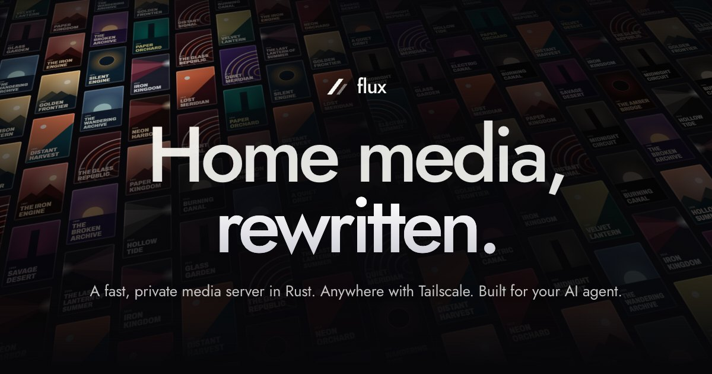
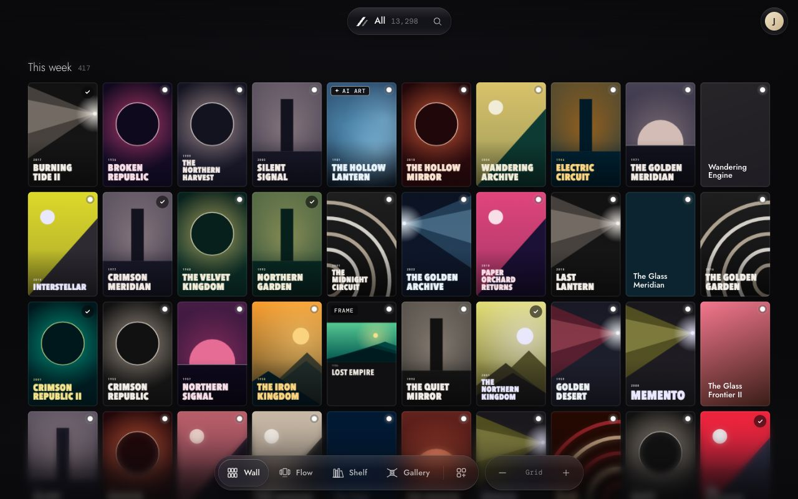
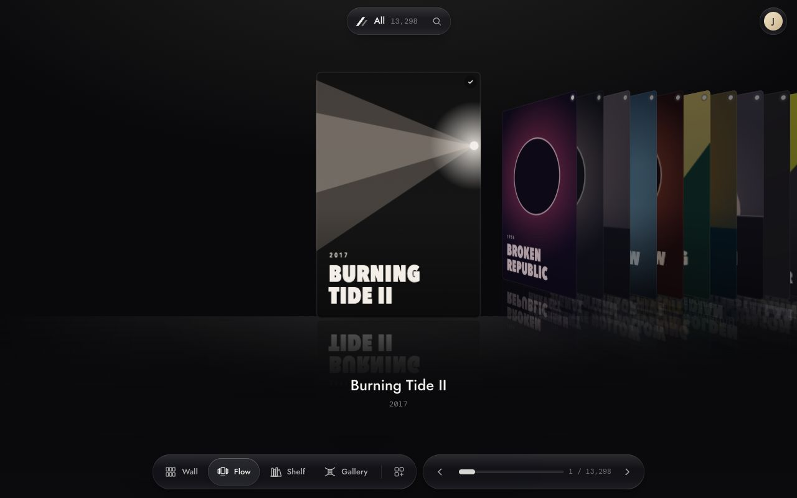
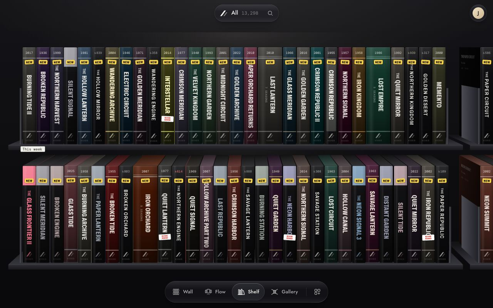
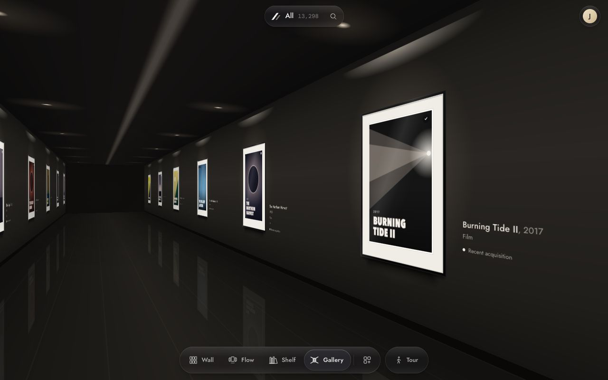
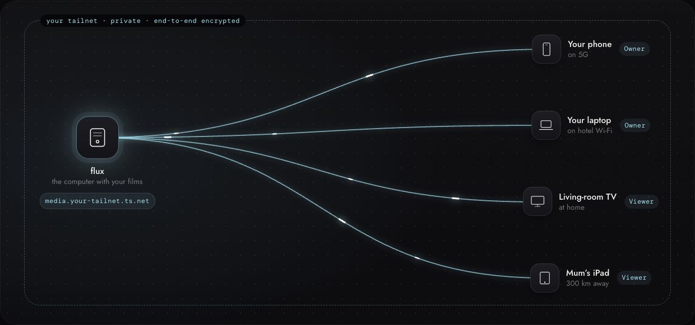
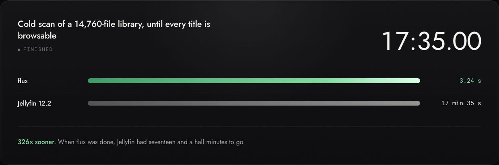
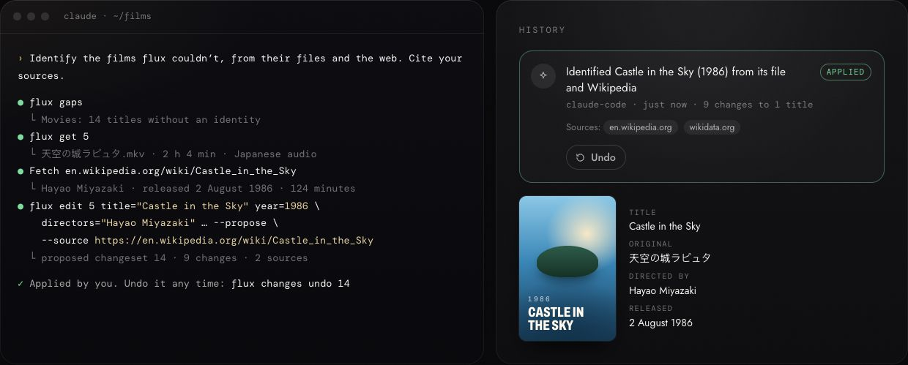

<p align="center">
  <a href="https://vibecook-dev.github.io/flux/"></a>
</p>

<p align="center">
  <b>Home media, rewritten.</b><br>
  A fast, private media server for the films and shows you own.<br>
  Written in Rust, reachable anywhere with a free Tailscale account, and built for the AI agent you already use.
</p>

<p align="center">
  <a href="https://vibecook-dev.github.io/flux/"><b>Website</b></a>&nbsp;&nbsp;·&nbsp;
  <a href="https://github.com/vibecook-dev/flux/releases">Download</a>&nbsp;&nbsp;·&nbsp;
  <a href="docs/INSTALL.md">Install</a>&nbsp;&nbsp;·&nbsp;
  <a href="docs/AGENT-NATIVE.md">For agents</a>&nbsp;&nbsp;·&nbsp;
  <a href="docs/prototype/benchmarks.md">Benchmarks</a>
</p>

<p align="center">
  <a href="https://github.com/vibecook-dev/flux/actions/workflows/ci.yml"></a>
  <a href="https://github.com/vibecook-dev/flux/releases"></a>
  <a href="LICENSE"></a>
</p>

flux is a media server for the films and shows you own. It scans a whole library in seconds, plays the moment you press play, reaches all your devices through your own Tailscale network, and works hand in hand with the AI agent you already use. Every playback plan and every metadata match comes with the reasons behind it. It is open source under the MIT licence, for macOS, Windows, Linux and Docker.

> **Status: alpha.** Releases are pre-releases (`0.1.0-alpha.N`) with packages for macOS, Linux and Windows and a Docker image ([Download](#download)); expect changes between them. flux was developed and benchmarked on macOS (Apple Silicon), and CI also builds and tests it on Linux (x86_64 and arm64) and Windows. It depends on changes to two libraries that are not all released yet (see [Prototype gaps](#prototype-gaps)). Read [Feature status](#feature-status) before you point it at a library you care about.

## Lenses: one library, every way to see it

Your films aren't a row of thumbnails in somebody's storefront. The library fills the window, and a lens decides how you see it; switch whenever the mood changes.

<table>
  <tr>
    <td width="50%"><br><b>Wall</b>: every title at a glance, from whole decades down to one poster. Pinch, or press + and −.</td>
    <td width="50%"><br><b>Flow</b>: one cover faces you; the rest wait in stacks you flick through.</td>
  </tr>
  <tr>
    <td width="50%"><br><b>Shelf</b>: tapes on a shelf, the way the video shop kept them. Point at one to pull it out.</td>
    <td width="50%"><br><b>Gallery</b>: walk your library like an exhibition, with a room for every decade.</td>
  </tr>
</table>

All four draw with WebGPU, so they keep up with a 120 Hz display: zooming through 10,000 posters on the Wall takes 3.6 ms of main-thread time a frame and drops none ([LENSES.md](docs/LENSES.md#drawing-on-the-gpu)). Where WebGPU isn't available, a DOM version of each stands in. Five more lenses come as examples of the lens kit (Tonight, Helix, Timeline, Film strip and Corkboard), and a lens is a small JSON file: describe the one you want and your agent writes it, for every device you use. They are all on the [website](https://vibecook-dev.github.io/flux/#lenses), running in the page.

## Anywhere: all it takes is a free Tailscale account

<p align="center"></p>

No port forwarding, no reverse proxy, no certificates to renew and no new passwords. flux joins your private tailnet, and the Tailscale login you already have is how you sign in, from the sofa, a hotel room or a train.

1. **Get Tailscale** on the computer with your films and on your devices. Its Personal plan is free, for up to six people.
2. **Switch on remote access**: one switch in flux's settings, or `--tailnet system`. flux uses the computer's Tailscale and answers on your tailnet, never on the open internet.
3. **Open it anywhere** at `https://<machine>.<tailnet>.ts.net:<port>`. With HTTPS on, flux uses your tailnet's own certificate, so even the GPU lenses work on your phone.

Your login is the Owner. Family and friends sign in with their own Tailscale accounts and can watch, and a grant in your tailnet policy (`vibecook.dev/cap/flux`) makes someone an Admin. Until you switch remote access on, flux listens on 127.0.0.1 only. The details are under [Remote access](#remote-access).

## Speed: built in Rust, measured against Jellyfin

<p align="center"></p>

flux saves time by skipping work rather than doing the same work faster. It reads container indexes instead of decoding, never re-probes a file that hasn't changed, never writes its database when nothing changed, and remuxes in process instead of starting ffmpeg. Titles are browsable while the first scan is still running, and a seek is a plain `GET` for one segment. It is one Rust program: memory-safe, no runtime to install, no garbage collector.

These figures come from [docs/prototype/benchmarks.md](docs/prototype/benchmarks.md) (2026-10-20, summary `flux-e-bench-summary-20261020-043247.json`), which ran flux and Jellyfin 12.2 through the same harness on the same machine. Each figure is a median. The playback rows give the range of the per-file medians. Ratios are Jellyfin's median ÷ flux's.

| | flux | Jellyfin 12.2 | Ratio |
|---|---|---|---|
| Cold scan, 16,671 files (14,760 media): everything browsable | **3.24 s** | 1,055 s | 326× |
| Cold scan: all background work finished | **10.19 s** | 1,055 s | 104× |
| Unchanged rescan (0 files opened, catalog untouched) | **142 ms** | 19.7 s | 138× |
| Add 50 movie folders → rescan → all 50 listed | **122 ms** | 21.4 s | 175× |
| Restart on the full catalog → API usable | **20.7 ms** | 5.02 s | 243× |
| Time to first segment after the play request, remux (6 files) | **2.8–17.9 ms** | 176–617 ms | 25–67× |
| Play request + first segment, same 6 files | **4.1–136 ms** | 187–634 ms | 1.5–50× |
| Seek far into a 2 h file, to a segment not produced before (page cache warm) | **1.3 ms** | 624 ms | 480× |
| Peak RSS over a full-library run | **100 MiB** | 544 MiB | 5.5× |
| Idle after the scans: RSS / phys footprint | **67 / 22 MiB** | 480 / 353 MiB | 7.2× / 16× |
| Install: stripped binary + web UI | **23.7 + 1.2 MiB** | 238 MiB | 9.6× (7.0× as built, 32.6 MiB unstripped) |

Not every result is a large win. A TrueHD 7.1 file that needs an audio transcode reaches its first segment in 113 ms against 395 ms (3.5×). The first play of a long MPEG-TS costs 136 ms against 205 ms (1.5×), because TS has no index and flux reads the whole file once to build one.

**Caveats. Read these before you quote a number.**

- **macOS, one M1 Max (64 GB).** Jellyfin mostly runs on Linux or Docker. Nothing was measured on Linux, a NAS, SMB or a spinning disk.
- **Synthetic corpus.** The scan library is 7 short seed clips (6 s each), cloned into 14,760 media files under messy names, plus 1,911 sidecars (NFOs, subtitles, artwork). Its file sizes and probe costs are not those of real films. The playback files are real encodes.
- **Shared machine.** Another project's dev server ran the whole time. Both servers ran at `nice -n 19`, the load average was 3.4–11.2, and the page cache was never purged. Each scan ran on a fresh APFS clone instead. Playback was page-cache-warm for both servers on purpose. None of these are cold-disk numbers.
- **Small samples.** The full library had 3 flux runs and 2 Jellyfin runs, and playback had n = 3 per file. Everything was timed server-side, over HTTP on loopback.
- **Jellyfin varies between sessions.** Its full cold scan took 900 s and 994 s in two earlier sessions on the same machine, at similar load. Against those, the cold-scan ratio to browsable would be about 280–310×, not 326×.
- **Different work, by design.** Jellyfin runs ffprobe on every file and reads NFOs and local artwork. flux probes headers in process and reads neither. Both ran with metadata fetching, background jobs and folder watching off.
- **No Plex baseline.** Plex needs an account claim to run, so it was not measured. Nothing here says anything about Plex.

## Agent-native: your agent knows more than any database

<p align="center"></p>

flux has no AI of its own. The agent you already use (Claude Code, Codex, Claude Desktop, anything that speaks MCP) is how a library gets identified, described, illustrated and organised, from the open web, which knows far more than any database about rare films, home recordings and old TV.

| | |
| --- | --- |
| **CLI** | `flux` ships with the server. Every command is one operation and prints JSON: `flux gaps`, `flux get 42`, `flux edit 42 title=… --source …`. |
| **MCP** | The same operations over MCP, at `/mcp` over HTTP or `flux mcp` over stdio: `claude mcp add --transport http flux http://localhost:8096/mcp`. |
| **Skills** | [`skills/`](skills) teach agents the jobs: identifying films, finding artwork, organising files, designing lenses. `flux skills install` puts them where your agent looks. |

Every change is a changeset with the pages it came from, and you can undo any of it in the app (Agents & changes) or with `flux changes undo`. An agent's changes can wait for an Owner or Admin to apply them, and nothing an agent sets is overwritten by flux's own matching. Agents also fix what flux read wrong, keep collections that show up as spaces, and plan renaming your files the way Plex, Jellyfin and Kodi expect, which runs only when you apply it. TMDB's text and images never reach an agent. See [docs/AGENT-NATIVE.md](docs/AGENT-NATIVE.md).

## Download

Releases are pre-releases (`0.1.0-alpha.N`) until the first stable one. The [website](https://vibecook-dev.github.io/flux/#download) offers the build for your system, and [docs/INSTALL.md](docs/INSTALL.md) has the steps for each way to install flux:

- **Homebrew** (macOS and Linux): `brew install vibecook-dev/tap/flux`, then `brew services start vibecook-dev/tap/flux`. ffmpeg comes with it. See [INSTALL.md § Homebrew](docs/INSTALL.md#homebrew-macos-and-linux).
- **A .deb or .rpm** (Debian and Ubuntu, Fedora and RHEL; x86_64 and arm64) that runs flux as a system service under an account of its own. See [INSTALL.md § Debian, Ubuntu, Fedora and RHEL](docs/INSTALL.md#debian-ubuntu-fedora-and-rhel).
- **Release packages** on [GitHub Releases](https://github.com/vibecook-dev/flux/releases), for macOS (Apple Silicon and Intel), Linux (x86_64 and arm64) and Windows (x86_64, a `.zip`), with `SHA256SUMS` and a build-provenance attestation per package. They don't bundle FFmpeg: install `ffmpeg` and `ffprobe` yourself (on `PATH`, or pass `--ffmpeg` / `--ffprobe`). See [INSTALL.md § Release packages](docs/INSTALL.md#release-packages).
- **Docker**: `ghcr.io/vibecook-dev/flux:<version>` for linux/amd64 and linux/arm64, and `edge` for the tip of `main`. It bundles [jellyfin-ffmpeg](https://github.com/jellyfin/jellyfin-ffmpeg), which is GPL; the image carries its licence and a link to its source, and each release attaches the matching source tarball. See [INSTALL.md § Docker](docs/INSTALL.md#docker).
- **Build from source**: see [Quickstart](#quickstart-build-from-source) below.

flux only ever runs `ffmpeg` and `ffprobe` as separate processes and never links the FFmpeg libraries ([DECISIONS.md](docs/DECISIONS.md)).

## Feature status

### Works today

- **Scanning.** A Mille directory walk (`getattrlistbulk`) and in-process header probes for MKV/WebM, MP4/MOV, MPEG-TS/M2TS and AVI, with ffprobe only as a fallback. Then a filename and folder parser, and a SQLite catalog. Items are browsable as soon as they are probed. A rescan that finds no changes opens no files and writes nothing. A filesystem watcher picks up changes. A drive or NAS that is offline makes its items *unavailable*, never deleted. A rename keeps watch state and resume points.
- **Playback.** Direct play with HTTP Range. Otherwise HLS (fMP4/CMAF), remuxed in process from MKV, MP4 and MPEG-TS/M2TS. ffmpeg transcodes audio per segment (TrueHD, DTS and others) and transcodes video when the client can't decode it (H.264 out through the first encoder that works: VideoToolbox, NVENC, Quick Sync, VAAPI or libx264, with HDR → SDR tone mapping; see [docs/ENCODERS.md](docs/ENCODERS.md)). Text subtitles (SRT, ASS, MP4 text tracks and subtitle files beside the video) play as WebVTT, and picture subtitles (PGS, VobSub) are burned into a transcode. Audio switching happens inside the session. Resume and watched state are kept.
- **Web client** (React 19, hls.js). The library fills the window, seen through a lens ([Lenses](#lenses-one-library-every-way-to-see-it)); the controls float over it as glass: the island at the top is the search, the space switcher and the place live events appear (scans, new titles, a drive going offline), and the lens bar at the bottom switches lenses. Item pages open over the library, and the player has a stats overlay. It installs as an app on secure pages (this computer, or HTTPS on the tailnet), opens when flux can't be reached, and says so when flux was updated under an open page ([INSTALL.md § The app on your devices](docs/INSTALL.md#the-app-on-your-devices)). The final product walk in Chrome passed 36/36 steps on the previous layout ([e2e.md](docs/prototype/e2e.md)).
- **Artwork and metadata.** Background jobs cut frame posters and backdrops from the files (no AI); they pause during playback and scans. Offline matching against TMDB's daily ID exports needs no key. It suggests candidates for review but auto-accepts none, because the exports carry no year or runtime. The TMDB API client takes your own key (`TMDB_READ_TOKEN` or `TMDB_API_KEY`).
- **Agents.** One contract (`flux.agent/1`, JSON Schemas in [`schemas/agent/v1`](schemas/agent/v1)) served over HTTP, MCP and the `flux` command line; every edit is a changeset with its sources, reviewed and undone in the app. flux reads `.flux.json` and Kodi `.nfo` files beside the videos. See [Agent-native](#agent-native-your-agent-knows-more-than-any-database) and [docs/AGENT-NATIVE.md](docs/AGENT-NATIVE.md).
- **Setting up.** On first run the web client walks the Owner through it: folders on the server (with a count of the videos in each and whether they look like films or shows), ffmpeg, and opening flux on other devices. A one-time owner link in the log, or from `flux-server owner-link`, makes a browser on another machine or a Docker host an owner ([docs/INSTALL.md § Setting flux up](docs/INSTALL.md#setting-flux-up)).
- **Updates.** flux checks GitHub for a new version once a day (switchable) and tells the Owner. A release package updates in place from the Libraries screen or with `flux-server update`: the download is checked against `SHA256SUMS` and the new binary tried before anything changes, the replaced version is kept for `flux-server update --rollback`, and the catalog is copied before a newer version migrates it. Docker and source installs are told what to run ([docs/INSTALL.md § Updating](docs/INSTALL.md#updating)).
- **Hardening.** A Host allowlist against DNS rebinding (421), a CSRF header on unsafe API calls (403), caps on connections and event streams, write timeouts and bounded caches. An adversarial review found 37 defects. All are fixed, each with a regression test. A re-verification then tried variants against every fix and hardened five of them further ([review.md](docs/prototype/review.md), [reverify.md](docs/prototype/reverify.md)).

### Prototype gaps

- **Platforms.** flux was developed and measured on macOS (Apple Silicon). CI also builds and tests it on Linux x86_64 and arm64 and on Windows x86_64, where video transcodes use libx264. Windows x86_64 is supported, with a release zip ([docs/INSTALL.md](docs/INSTALL.md#windows)): it was checked against a real library on Windows 11 with NVENC on an NVIDIA GPU. Quick Sync on Windows is detected but untested, and AMD's AMF encoder isn't used, so AMD GPUs transcode with libx264. The Linux hardware encoders (NVENC, Quick Sync, VAAPI) are detected at runtime ([docs/ENCODERS.md](docs/ENCODERS.md)) but not yet tested on real GPUs.
- **Unreleased dependencies.** flux uses Mille (file walking and watching) and Truffle (embedded Tailscale), two libraries by the same maintainer, and needs changes to both that were made for flux. Mille comes as a git dependency from [vibecook-dev/mille](https://github.com/vibecook-dev/mille), pinned to the commit that merged flux's changes. Truffle's `truffle-core` comes from crates.io (0.7.20, the release with flux's changes). To build against local checkouts of either, see [CONTRIBUTING.md](CONTRIBUTING.md#local-mille-and-truffle-checkouts).
- **Remote access is partly tested.** System mode serves a Windows 11 machine's library over the tailnet and was used from another device there (WhoIs identity, a direct path, HTTPS on the tailnet). Embedded mode has never joined a real tailnet; its serving path is tested with fabricated identities.
- **Roles and sharing.** Adding libraries, scanning and switching remote access need Owner or Admin. Beyond that, roles are not enforced: Kid and Guest see everything. LAN callers are anonymous unless an owner link made their browser an owner; there are no other accounts. The web client's invite flow has no server API yet.
- **Playback.**
  - Video transcodes have one H.264 bitrate (no ABR ladder).
  - Picture subtitles (PGS, VobSub) show only by burning them in, which forces a video transcode. ASS shows as plain text.
  - Matroska rotation is ignored, and Dolby Vision profile 7 plays as its HDR10 base layer.
  - The first play of an MPEG-TS reads the whole file to index it. From a cold HDD or NAS that would take seconds (not measured).
- **Metadata.** The TMDB API client has never run against the live API, because testing had no key. TMDB data is not yet refreshed within the API terms' 6-month cache limit.
- **Clients.** Chrome is the only browser driven end to end. Safari, iOS and Firefox are covered by unit tests only. There are no native or TV apps yet. Jellyfin-API compatibility is not planned: flux builds its own web client and apps ([DECISIONS.md](docs/DECISIONS.md)).
- **Operations.** HTTP/1.1 only. The release packages, the Docker image and the systemd unit in [docs/INSTALL.md](docs/INSTALL.md) are new with the first pre-release, v0.1.0-alpha.1. CI smoke-tests every package (`x86_64-apple-darwin` under Rosetta 2, and the Windows zip stopped with Ctrl-C and Ctrl-Break) and the image on both platforms, but none of them has run as a long-lived service.

The full lists are in [fixes.md §7](docs/prototype/fixes.md#7-open-items), [e2e.md §5](docs/prototype/e2e.md#5-remaining-gaps-by-priority), [benchmarks.md §8](docs/prototype/benchmarks.md#8-gaps) and each component report in `docs/prototype/`.

## Quickstart (build from source)

**Prerequisites**

- macOS, Linux (x86_64 or arm64) or Windows (x86_64). flux was developed on macOS (Apple Silicon); CI builds and tests it on all three. On Linux you also need a C compiler and `make` (Debian/Ubuntu: `build-essential`) for the bundled SQLite and jemalloc; on Windows, the MSVC toolchain (Visual Studio Build Tools with "Desktop development with C++"), which rustup asks for.
- Rust stable. The workspace's `rust-version` is 1.89; CI lints and tests with 1.99.1.
- `ffmpeg` and `ffprobe`, on `PATH` or from Homebrew (developed with 9.0.2). flux uses them for transcodes, frame posters and probe fallbacks.
- Node.js and pnpm (`pnpm@11.13.1`), to build the web UI.
- For embedded remote access only: Go, to build Truffle's `sidecar-slim`.

**Build**

```sh
git clone https://github.com/vibecook-dev/flux && cd flux
cargo build --release -p flux-server
(cd web && pnpm install --frozen-lockfile && VITE_FLUX_API=/ pnpm build)    # → web/dist, served by flux-server
```

**Run**

```sh
target/release/flux-server \
  --library Movies:movies:/path/to/Movies \
  --library TV:shows:/path/to/TV
```

Open <http://127.0.0.1:8096> and follow *Set up flux*. Libraries named on the command line are created on first run and scanned at startup, so `--library` can stand in for setting up. Run from the repo root so that `web/dist` is found, or pass `--web-dir`. Ctrl-C stops the server gracefully. The catalog, caches and artwork go in `~/Library/Application Support/flux` (macOS) or `~/.local/share/flux` (Linux) unless you pass `--data-dir`; the log's first line names the folder.

**Options** (`flux-server --help`). Each flag can also come from its environment variable, or from a TOML file (`--config`). Flags win over variables, and variables win over the file.

| Flag | Variable | Default and meaning |
|---|---|---|
| `--library NAME:KIND:PATH` | `FLUX_LIBRARIES` (`;`-separated) | A library to create on first run (repeatable). KIND is `movies`, `shows`, `mixed` or `videos` (home videos and clips: one item per file, titled after the file, browsed by folder, never matched; `home` and `other` are accepted too). A folder can be in only one library: if a new library's folder is another library's, or inside or around it, flux-server stops at startup and says why. |
| `--data-dir DIR` | `FLUX_DATA_DIR` | `~/Library/Application Support/flux` on macOS, `%LOCALAPPDATA%\flux` on Windows, `$XDG_DATA_HOME/flux` or `~/.local/share/flux` elsewhere |
| `--port PORT` / `--bind IP` | `FLUX_PORT` / `FLUX_BIND` | 8096 / 127.0.0.1. Callers on this listener are the Owner. |
| `--lan ADDR:PORT` | `FLUX_LAN` | Off. Also listen on the LAN, e.g. `0.0.0.0:8097`. LAN callers are anonymous. |
| `--tailnet off\|embedded\|system` | `FLUX_TAILNET` | `off`. See [Remote access](#remote-access). |
| `--tailnet-https[=BOOL]` | `FLUX_TAILNET_HTTPS` | Off. Also serve HTTPS on the tailnet, with its MagicDNS certificate. See [HTTPS](#https). |
| `--allow-host HOST` | `FLUX_ALLOW_HOSTS` (`,`-separated) | Extra host names the server answers to, e.g. a reverse proxy's (repeatable). Other hosts get 421. |
| `--localhost-role ROLE` | `FLUX_LOCALHOST_ROLE` | `owner`. Use `none` on a machine other people can log in to. |
| `--owner-login LOGIN` | `FLUX_OWNER_LOGIN` | The tailnet login that owns the server. Default: learned when the tailnet starts. |
| `--name NAME` | `FLUX_NAME` | Server name shown to clients and used for the tailnet device. Default: the host name. |
| `--web-dir DIR` | `FLUX_WEB_DIR` | `./web/dist`, or next to the binary |
| `--no-scan` / `--no-jobs` / `--no-watch` | `FLUX_NO_SCAN` / `FLUX_NO_JOBS` / `FLUX_NO_WATCH` | Turn off scanning, background jobs (matching, posters) or folder watching. |
| `--ffmpeg PATH` / `--ffprobe PATH` | `FLUX_FFMPEG` / `FLUX_FFPROBE` | From `PATH` or Homebrew. ffprobe defaults to the one next to ffmpeg. |
| `--tmdb-exports DIR` | `FLUX_TMDB_EXPORTS` | `<data-dir>/tmdb-exports`. TMDB daily ID exports for offline matching. |
| `--log FILTER` | `FLUX_LOG` | `info`, or `RUST_LOG` |
| `--update-check[=BOOL]` | `FLUX_UPDATE_CHECK` | On. Check GitHub for a new flux once a day (GitHub sees the address and flux's version). Without this flag the Libraries screen can switch it off. See [docs/INSTALL.md § Updating](docs/INSTALL.md#updating). |
| `--config FILE` | `FLUX_CONFIG` | A TOML config file |

`flux-server service install` makes flux start by itself, as a LaunchAgent on macOS, a systemd user unit on Linux or a Windows service, with the `--config`, `--data-dir`, `--port` and `--bind` you give it ([docs/INSTALL.md § Starting with your Mac or PC](docs/INSTALL.md#starting-with-your-mac-or-pc), [§ As a Windows service](docs/INSTALL.md#as-a-windows-service)); `service status`, `stop`, `start` and `uninstall` go with it. Two commands act on a running flux: `flux-server update` ([§ Updating](docs/INSTALL.md#updating)) and `flux-server owner-link` ([§ The owner link](docs/INSTALL.md#the-owner-link)). Give them the server's `--config`, `--data-dir` or `--port`, if it has them, so they find it.

In the TOML file, keys are the long flag names with `_`. `--no-scan`, `--no-jobs` and `--no-watch` become `scan = false`, `jobs = false` and `watch = false`, and each library is a `[[library]]` table:

```toml
data_dir = "/srv/flux"
tailnet = "off"                  # off | embedded | system
tailnet_https = false            # HTTPS on the tailnet
allow_host = ["media.example.com"]
[[library]]
name = "Movies"
kind = "movies"                  # movies | shows | mixed | videos
path = "/Volumes/NAS/Movies"
```

### Remote access

`--tailnet` picks one of three modes. You can also switch modes on the web client's Connect screen. The choice is remembered in the data dir, and switching replaces only the tailnet listener, so local streams carry on. A `--tailnet` flag or `FLUX_TAILNET` wins over the remembered choice.

- **`off`** (the default): only 127.0.0.1, plus `--lan` if you set it. flux runs `tailscale status` once at startup so the Connect screen can offer this machine's Tailscale, unless `--tailnet off` or `FLUX_TAILNET=off` is given explicitly.
- **`system`**: uses this machine's running Tailscale. flux binds the machine's Tailscale addresses on its port and identifies each caller with `tailscale whois`.
- **`embedded`**: flux runs its own Tailscale node through Truffle. It needs Truffle's Go `sidecar-slim`, found through `TRUFFLE_SIDECAR_PATH` or next to the binary. On first start, the Connect screen (or `GET /api/v1/tailnet`) shows a login link and QR code. After you sign in, the server is on your tailnet as `http://truffle-flux-<name>.<tailnet>.ts.net:8096`.

#### HTTPS

Browsers offer some features only to secure pages, WebGPU among them (the Wall, Flow and Shelf draw with it), and plain HTTP from another device isn't one, even inside the tailnet's encrypted tunnel. Switch on **Secure link (HTTPS)** on the Remote access screen, or pass `--tailnet-https`, and tailnet devices can open flux at `https://<machine>.<tailnet>.ts.net:<port>` with the tailnet's own Let's Encrypt certificate. It needs MagicDNS and HTTPS certificates turned on for the tailnet (Tailscale admin console, DNS page). Like any public certificate, it puts the machine's name in public Certificate Transparency logs.

- **`system`**: flux gets this machine's certificate from tailscaled (`tailscale cert`) and serves HTTPS and plain HTTP on the same port: the first byte of a connection tells them apart, so `http://` links keep working. It asks again every 12 hours; tailscaled renews the certificate before it expires. A page opened over plain HTTP on the tailnet moves to the same route at the HTTPS address once it has checked it can reach it from that device. Until the certificate arrives, or if the tailnet issues none, the Remote access screen says why.
- **`embedded`**: Truffle's node serves HTTPS only, on the same port.

The setting is remembered in the data dir, like the mode; `--tailnet-https` or `FLUX_TAILNET_HTTPS` wins over it.

On the tailnet, Tailscale tells flux who each caller is. The login that owns the node is the Owner, unless `--owner-login` names another. A `vibecook.dev/cap/flux` capability grant in your tailnet policy (`{"role": "kid"}`, `"viewer"`, `"admin"`, …) sets anyone else's role, and the default is Viewer. Nothing is exposed to the public internet, and flux has no passwords of its own. Embedded mode hasn't run end to end yet (see [Prototype gaps](#prototype-gaps)).

## Architecture

The principles are to skip work rather than speed it up, to make every playback segment a pure function of `(asset, recipe, index)`, to explain every decision, to bound every queue and cache, and to treat an unreachable folder as *unavailable*, never deleted. A scan walks the roots with Mille and diffs them against the catalog by `(dev, ino, size, mtime)`. Only new or changed files are probed and parsed, then committed in batches by one writer. `POST /api/v1/play` asks the planner for a plan, with its reasons. The client then fetches the original file with Range requests, or HLS segments, each built from one source byte range. Details are in [docs/ARCHITECTURE.md](docs/ARCHITECTURE.md).

| Crate | Role |
|---|---|
| `flux-core` | Shared plain-data types: media facts, name guesses, plans, API DTOs |
| `flux-probe` | Sans-IO header probe for MKV/WebM, MP4/MOV, MPEG-TS/M2TS and AVI; ffprobe as oracle and fallback |
| `flux-names` | Filename and folder parser: canonical fast path → hunch (guessit port) → post-rules |
| `flux-catalog` | SQLite catalog (WAL): schema, one batched writer, read queries |
| `flux-scan` | Scan orchestrator: Mille walk → diff → probe → parse → write; watcher; background fingerprints |
| `flux-hls` | Playback planner and index, stateless fMP4/CMAF segmenter, HLS playlists, ffmpeg transcodes |
| `flux-meta` | TMDB client, offline export index, matcher, AI hypothesis trait, frame posters and opt-in AI posters |
| `flux-net` | Local, LAN and tailnet listeners (Truffle or system Tailscale), WhoIs identity, admission limits |
| `flux-server` | The binary: axum routes, sessions, jobs, SSE, static web UI; agent operations and MCP |
| `flux-cli` | `flux`, the command line: the agent operations from a terminal, and MCP over stdio |
| `web/` | React 19 + TypeScript + Vite client (hls.js) |
| `tools/` | Corpus generators and benchmark harnesses |

Dependencies point downward only: `server → {scan, hls, meta, net, catalog}`, `scan → {catalog, probe, names}`, `hls → probe`, and every crate → `core`. `flux-cli` talks to a running server over HTTP and depends on `core` only.

## Tests and benchmarks

```sh
cargo build --workspace --all-targets
cargo clippy --workspace --all-targets      # expected: 0 warnings
cargo test --workspace
cargo fmt --all --check
(cd web && pnpm typecheck && pnpm lint && pnpm test && pnpm build)
```

- **Test media.** Tests that need media read the corpus from the directory in `FLUX_TEST_MEDIA` ([CONTRIBUTING.md](CONTRIBUTING.md#media-corpus-tests)). They are written to skip themselves when it is missing. `tools/corpus/gen-features.sh [OUT]` regenerates the feature clips from ffmpeg test sources. `tools/corpus/gen-library.py --out DIR` regenerates the messy 16.7k-file library, made of APFS clones with a ground-truth manifest.
- **Opt-in tests.** A few are `#[ignore]`d on purpose: live TMDB, live Ollama, this machine's tailscaled, and the probe's deep fuzz.
- **Head-to-head benchmark.** `tools/bench/headtohead.py` runs the flux-vs-Jellyfin scan, startup and playback protocol. It waits for low machine load before each measured phase. It needs `FLUX_WORK`, a scratch directory for results and APFS clones, and `FLUX_TEST_MEDIA` (default `$FLUX_WORK/media`), plus a Jellyfin 12.2 build. The exact commands are in [benchmarks.md §7](docs/prototype/benchmarks.md#7-re-running).
- **Browser end to end.** `cd web && pnpm e2e` walks the product and measures playback in Google Chrome through playwright-core ([e2e.md](docs/prototype/e2e.md)).
- **Playback validation.** flux-hls's `hls-validate` checks the corpus against client presets, decoding the output and counting frames and packets against the source ([hls.md](docs/prototype/hls.md)).

## Open decisions

These are still open. They come from [research/00-synthesis.md](research/00-synthesis.md) and [research/09](research/09-fact-check-and-gaps.md). The settled ones (the licence, no Jellyfin-API compatibility, and how flux uses FFmpeg) are recorded in [docs/DECISIONS.md](docs/DECISIONS.md).

1. **TMDB API terms.** Without a written agreement, TMDB allows non-commercial use only. Its terms also forbid using TMDB content "in connection with" an AI-based application, and they cap caching at 6 months. research/09 notes that the AI clause may cover the whole product, not just the AI matcher. The plan is to ask TMDB for written permission before shipping a server product with a flux project key and AI-assisted matching. Meanwhile, the design keeps TMDB data out of every AI path.
2. **Apple TV and native clients.** One option is to rely on the official Tailscale tvOS app beside a flux app (two apps). The other is to embed Tailscale in the flux tvOS app (one app, unproven on tvOS). The client mix also decides which engine work matters most.

## Documentation

- [vibecook-dev.github.io/flux](https://vibecook-dev.github.io/flux/): the website ([site/](site/)), with the web client in the page.
- [docs/INSTALL.md](docs/INSTALL.md): release packages, Windows, Docker, a systemd unit, upgrading and building from source.
- [docs/RELEASING.md](docs/RELEASING.md): how releases are made and verified.
- [docs/ARCHITECTURE.md](docs/ARCHITECTURE.md): the contract the crates are built against.
- [docs/AGENT-NATIVE.md](docs/AGENT-NATIVE.md): flux for agents: the operations, MCP, the `flux` command line, skills, changesets and what agents are never shown.
- [docs/LENSES.md](docs/LENSES.md): the web client's lenses and the lens kit.
- [docs/prototype/](docs/prototype/): one report per component, plus [benchmarks.md](docs/prototype/benchmarks.md), [e2e.md](docs/prototype/e2e.md), [review.md](docs/prototype/review.md), [fixes.md](docs/prototype/fixes.md), [reverify.md](docs/prototype/reverify.md) and [audit.md](docs/prototype/audit.md) (every published number traced to its result file).
- [docs/DECISIONS.md](docs/DECISIONS.md): settled project decisions and why.
- [research/](research/): the research behind the design, starting with [00-synthesis.md](research/00-synthesis.md).

## Contributing

See [CONTRIBUTING.md](CONTRIBUTING.md) for building, testing, commit conventions and working against local Mille and Truffle checkouts. Report security issues privately, as described in [SECURITY.md](SECURITY.md). Everyone taking part is expected to follow the [Code of Conduct](CODE_OF_CONDUCT.md).

## Licence

flux is released under the [MIT licence](LICENSE), Copyright (c) 2026 James Yong. The Docker image also contains jellyfin-ffmpeg, which is GPL-licensed and runs only as a separate process.
