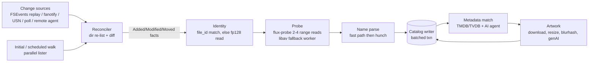

# 02 — State-of-the-art media library scan engine for flux

*Research date: 2026-10-18. Author: flux research agent (scan-engine track). Status: research + measured micro-prototypes; no flux code written yet.*

**Confidence tags:** **[V]** verified against primary source (code, spec, man page, official docs) or measured locally · **[M]** measured locally (numbers in Appendix A) · **[I]** my inference / design judgement · **[L]** low-confidence secondary source (forum, blog).

**Measurement caveat (applies to every [M] number):** measured on the maintainer's Apple M1 Max (8P+2E cores, 64 GB) with macOS Darwin 25.5, on an **APFS volume on a USB-attached Samsung SSD**. The machine was **heavily shared during the runs**: load average 64–104 on 10 cores, with other agents running Jellyfin, ffmpeg and a Mille walk bench at the same time. All runs were **warm page cache**; macOS cannot drop caches without `sudo purge`, which I did not run. Treat the absolute numbers as pessimistic and the *ratios* between methods as the meaningful result. The harness lives at `$FLUX_WORK/scan-bench/` (`src/bin/{walk,probe,spawn,sqlite,names,fsev}.rs`) and can be re-run unchanged.

---

## 0. TL;DR

1. **Jellyfin's scan cost is structural** [V]. It walks every library folder, runs a resolver chain, and derives item IDs from `MD5(type + lowercased path)`, so a rename becomes a delete plus an add. It spawns **one `ffprobe` per media file** with `-analyzeduration 200M -probesize 1G … -show_frames -only_first_vframe`. It then runs metadata, image and blurhash providers per item and writes through EF Core. Library scans in 10.11.0 regressed from **2 m 30 s to 29 m 53 s** for one reporter ([jellyfin#15070](https://github.com/jellyfin/jellyfin/issues/15070)).
2. **The `ffprobe` subprocess costs 17–28 ms per file before any media work** [M] (`-version` spawn floor: upstream dylib build 16.6 ms, jellyfin-ffmpeg static build 28.2 ms). A realistic probe costs **30–116 ms per file**, and throughput tops out around **140–180 files/s with 8 parallel probes**. **In-process header parsing costs 0.01–0.11 ms per typical file** (≈6 ms for a 2-hour file's 4.4 MB `moov`) [M], roughly two to three orders of magnitude less.
3. **Jellyfin's default probe settings read far too much from MPEG-TS/M2TS** [V+M]. With `analyzeduration=200M` (200 s) and `probesize=1G` ([ConfigurationOptions.cs:18-19](https://github.com/jellyfin/jellyfin/blob/08c2ba6e0b6499122822f1c5b18bc426104538b4/Emby.Server.Implementations/ConfigurationOptions.cs#L18-L19)), ffprobe read **34.6 MB of a 5-minute TS** in my test, against 1.1 MB at ffprobe's defaults and **64 KB for the same content in MKV**. At Blu-ray bitrates that is hundreds of MB per M2TS file.
4. **Directory enumeration: `getattrlistbulk` is clearly faster on APFS** [M]. On 80,800 files in 6,402 directories it took **250 ms single-thread vs 490 ms for `read_dir`+`lstat`** (1.96×) and **96 ms when parallel vs 150 ms for parallel std** (5.1× vs the sequential std baseline). Older published data is mixed ([Tempelmann 2019](https://blog.tempel.org/2019/04/)), so measure per filesystem.
5. **A zero-change rescan should touch zero files** [M+I]:
   - **macOS:** FSEvents replays history from a persisted event ID. I verified that create, rename, modify and delete events made *while no watcher was running* were replayed, with `HistoryDone` reached after **≈30 ms**.
   - **Linux and polled shares:** a Kodi-style directory-mtime pass costs **9.5 ms for 6,402 directories**, ≈50× cheaper than a full walk.
   - **Gap:** the `notify` crate hard-codes `kFSEventStreamEventIdSinceNow`, so flux needs its own FSEvents layer.
6. **Probing: write a small sans-IO, range-read-driven `flux-probe`** for MKV, MP4, TS and AVI, and use crates for codec configuration (`h264-reader`, `hevc_parser`, `dolby_vision`). Keep libavformat (ffprobe or `ffmpeg-next` in a worker process) only as a fallback and as a differential-testing oracle.
   - **MKV:** `matroska-demuxer` behind a `BufReader` read **159 MB to open a 118 MB, 2-hour MKV (36,163 seeks)**. The same parse behind a 64 KiB page cache read **171 KB in 3 reads** [M].
   - **MP4:** only **1,106 bytes of a 4.43 MB `moov`** are needed for scan metadata. The rest is sample tables (`stts`, `stsz`, `stco`) [M].
7. **HDR10 static metadata (MDCV/CLL) was not in the container** for ffmpeg+x265 HEVC files (MKV or MP4). It existed only in SEI in the first frame [M]. That is why Jellyfin added a jellyfin-ffmpeg patch to decode the first video frame (`-only_first_vframe`, [patch 0066](https://github.com/jellyfin/jellyfin-ffmpeg/blob/jellyfin/debian/patches/0066-add-first-vframe-only-to-ffprobe.patch)). flux should parse the **first keyframe's SEI NALs** (a few hundred KB, no decoding) only for PQ/HLG/DoVi tracks.
8. **Identity** [V+M]:
   - **Locations:** key them by `(source, relative path)`.
   - **Files:** key them by `(volume UUID, file ID)` plus birthtime for rename tracking. Locally, rename preserved inode, birthtime and mtime; `cp -p` and `cp -c` produced a new inode with the *same* birthtime and mtime.
   - **Content fingerprint:** `size + xxh3-128(first 64 KiB ‖ last 64 KiB)` (≈23 µs warm). Compute the OpenSubtitles hash from the same 128 KiB.
   - **Full BLAKE3:** lazily and in the background only, at ≈0.7–1 GB/s.
9. **SQLite is not the bottleneck if used correctly** [M]:
   - **Batched writes:** rusqlite batched inserts ran at **110k–270k rows/s**, against **6–13k rows/s with autocommit**.
   - **Reconcile:** loading 100k rows into a HashMap took 25–32 ms.
   - **Responsiveness:** WAL reader point queries kept **p99 ≤ 0.15–0.9 ms** during bulk inserts.
   - **Shape:** use one writer thread and many readers.
10. **Filename parsing:** use `hunch` 2.0.2, a Rust guessit port claiming 81.8% of guessit's 1,310 test cases. On my 36-case set it scored **33/36 titles vs 29/36** for `torrent-name-parser` [M]. It is slow (≈0.37 ms/name), so wrap it in an *arr-naming fast path plus explicit-ID extraction, and only run it on new or changed files.

---

## 1. How the incumbents actually scan

### 1.1 Jellyfin (source-level, commit `08c2ba6e`, 2026-10-17) [V]

I cloned [jellyfin/jellyfin](https://github.com/jellyfin/jellyfin) at `08c2ba6e0b6499122822f1c5b18bc426104538b4`. All `file:line` references below are at that commit; prefix `https://github.com/jellyfin/jellyfin/blob/08c2ba6e/`.

**Control flow of a library scan**

| Step | What happens | Source |
|---|---|---|
| 1 | `PerformLibraryValidation` → `ValidateTopLibraryFolders` → `RootFolder.ValidateChildren(recursive: true)`, then `RunPostScanTasks` (people, genres, studios, artists, collections) | `Emby.Server.Implementations/Library/LibraryManager.cs:1490-1505`, `:1516+` |
| 2 | For each folder: `GetNonCachedChildren` = `LibraryManager.ResolvePaths(GetFileSystemChildren(...))` runs the **resolver chain** (Movie, TV, Audio, Book, Photo, Extras… resolvers using `Emby.Naming` regexes) over the directory listing | `MediaBrowser.Controller/Entities/Folder.cs:920-925` |
| 3 | Children are compared to the DB **by item ID**; new → `newItems`, missing → removal; unchanged → `UpdateFromResolvedItem`, else `LibraryManager.UpdateImagesAsync(currentChild)` (image dimension/blurhash repair) | `Folder.cs:417-560` |
| 4 | Item ID = `MD5(type.FullName + path)`, path lower-cased unless `EnableCaseSensitiveItemIds` | `LibraryManager.cs:797-818` |
| 5 | `RefreshMetadataRecursive` → per-item `MetadataService` → providers: local (NFO), **ProbeProvider** (ffprobe), remote (TMDB/TVDB/OMDb…), image providers | `Folder.cs:831-870` |
| 6 | `ProbeProvider.HasChanged`: re-probe if `LastWriteTimeUtc` changed, media info missing, or the set of external subtitle/audio files changed | `MediaBrowser.Providers/MediaInfo/ProbeProvider.cs:127-180` |
| 7 | ffprobe is a **separate process per file**: `{probesize/analyzeduration} -i {file} -threads {n} -v warning -print_format json -show_streams -show_chapters -show_format` + `-show_frames -only_first_vframe` for local video files | `MediaBrowser.MediaEncoding/Encoder/MediaEncoder.cs:513-535` |
| 8 | Video probes always request chapters (`ExtractChapters = true`) | `MediaBrowser.Providers/MediaInfo/FFProbeVideoInfo.cs:170-173` |
| 9 | Defaults: `FFmpeg:probesize = "1G"`, `FFmpeg:analyzeduration = "200M"` | `Emby.Server.Implementations/ConfigurationOptions.cs:18-19` |
| 10 | DoVi from stream side data (`DOVI configuration record`); **HDR10+ only from the first decoded frame's side data** | `MediaBrowser.MediaEncoding/Probing/ProbeResultNormalizer.cs:933-971` |
| 11 | Image blurhash computed per image during scan | `LibraryManager.cs:2536`, `:2632` |
| 12 | Concurrency: `LibraryScanFanoutConcurrency` unset ⇒ **cores − 3** runners (sequential if ≤ 3 cores) | `MediaBrowser.Controller/LibraryTaskScheduler/LimitedConcurrencyLibraryScheduler.cs:161-178` |
| 13 | Real-time monitor: .NET `FileSystemWatcher` per library path, `IncludeSubdirectories = true`, `InternalBufferSize = 65536`, changes debounced by `LibraryMonitorDelay = 60` s | `Emby.Server.Implementations/IO/LibraryMonitor.cs:255-264`; `MediaBrowser.Model/Configuration/ServerConfiguration.cs:172` |
| 14 | User watch-state keys use provider IDs (IMDb/TMDb) where present, so a renamed file *can* re-attach watch state after a successful re-match | `MediaBrowser.Controller/Entities/Video.cs:293-315` |

The `-only_first_vframe` flag is **not upstream FFmpeg**. It is jellyfin-ffmpeg's `debian/patches/0066-add-first-vframe-only-to-ffprobe.patch` [V: GitHub code search on `jellyfin/jellyfin-ffmpeg`]. Upstream ffprobe 7.1 lacks it, while jellyfin-ffmpeg 8.1.3 has it [V: `-h` output of both binaries]. Jellyfin probes for support at start-up (`MediaEncoder.cs:238`).

**What dominates Jellyfin's scan time** (inference, ranked by my estimate for a first scan) [I]:
1. **Remote metadata and images.** These are network-latency bound, and plugins add more. A moderator notes that plugins such as Jellyscrub, Intro Skipper and OpenSubtitles "can extend the scan time significantly" [L: [forum](https://forum.jellyfin.org/t-slow-library-scans-fix)].
2. **Per-file `ffprobe` with heavy options.** My measurements (§5.1) show 33–116 ms per file warm, versus ≈29 ms for the same probe without `-show_frames -only_first_vframe` (§5.1 table). On M2TS, the 200 s analyze window means reading hundreds of MB per file.
3. **Database writes through EF Core.** In jellyfin#15070 the reporter saw `Failed executing DbCommand (30,297ms)` on `INSERT INTO "BaseItemImageInfos"`. A core developer explained that scans in 10.11 "are expected to take (way) longer … because we are now a) properly validating all existing data and b) properly applying concurrency limits" ([#15070](https://github.com/jellyfin/jellyfin/issues/15070), 110 comments).
4. **Rescans of unchanged libraries are not zero-I/O.** Every folder is listed and resolved again, and unchanged children still go through `UpdateImagesAsync` (`Folder.cs:500-507`).

Field reports are consistent with this: ffprobe stalls that hold up the whole scan, and the web UI becoming "almost unusable" during scans on a NAS ([forum](https://forum.jellyfin.org/t-initial-media-scan-taking-a-very-long-time), [forum](https://forum.jellyfin.org/t-solved-ffprobe-under-scan-media-library-problematic)) [L].

**Emby.Naming** is the regex filename parser Jellyfin inherited from Emby's naming library. It has 27 `EpisodeExpression`s, two `CleanDateTimes` regexes, a long `CleanStrings` token list, stacking rules (`cd1`/`part2`), 3D-format, stub and extras rules (`Emby.Naming/Common/NamingOptions.cs`, 930 lines) [V]. It is order-sensitive. Its own comments document false positives that later rules guard against (`NamingOptions.cs:353-377`).

### 1.2 Plex (closed source; documented behaviour) [M/L]

- **Pipeline:** scanning is a **separate process** (`Plex Media Scanner`) with flags such as `--scan`, `--refresh`, `--analyze` and `--analyze-deeply`. The last "fully reads the file and performs deep media analysis" ([Plex support: Plex Media Scanner via command line](https://support.plex.tv/articles/201242707-plex-media-scanner-via-command-line/), as quoted by search results; the page returns 403 to fetches) [M]. Plex documents three stages: *scan* (add files), *analysis* (codec, resolution, bitrate, thumbnail), then *matching* via agents ([Analyze media](https://support.plex.tv/articles/200289336-analyze-media/), [Matching process](https://support.plex.tv/articles/200889878-matching-process/)) [M].
- **Change detection:** "Scan my library automatically" relies on OS change notifications. "Run a partial scan when changes are detected" scans "only the folder which changed". Plex says auto-detection for "content mounted via a network will also typically not work" ([Plex Library settings](https://support.plex.tv/articles/200289526-library/)) [V]. A Plex staffer says partial scans are driven by inotify for natively mounted filesystems only ([forum](https://forums.plex.tv/t/partial-scan-not-working/351358)) [L].
- **Deep analysis** "will read the entire file from start to finish" to build a peak-bitrate profile (`requiredBandwidths`) ([forum](https://forums.plex.tv/t/deep-analysis/170280)) [L]. This runs at add time or during maintenance.
- **Catalogue:** SQLite (`com.plexapp.plugins.library.db`), repaired with Plex's bundled "Plex SQLite" ([Plex support](https://support.plex.tv/articles/repair-a-corrupted-database/)) [M].

### 1.3 Kodi (source-level, `xbmc/xbmc` master `18bce6d`, 2026-10-18) [V]

Kodi's video scanner is the best prior art for **cheap incremental scans**:
- `CVideoInfoScanner::GetFastHash` hashes the directory's `st_mtime` (or `st_ctime` if mtime is 0) together with the exclude regexes. It is used only when `CanFastHash` is true, i.e. **the directory has no sub-folders**, because a parent's mtime does not change when a grandchild changes. ([VideoInfoScanner.cpp:2829-2869](https://github.com/xbmc/xbmc/blob/master/xbmc/video/VideoInfoScanner.cpp))
- Otherwise `GetPathHash` hashes every item's path, size and mtime, at 1 s precision to normalise Linux/Windows differences (`:2758-2805`). TV series folders use `GetRecursiveFastHash`, which sums the mtimes of all sub-directories (`:2871+`).
- A matching hash logs `Skipping dir '…' due to no change` and skips the listing entirely. Hashes are stored in the `path` table.
- **Known weakness:** some network or cloud mounts don't update directory mtime, so users set `<usefasthash>false</usefasthash>` and accept much slower scans ([Kodi forum](https://forum.kodi.tv/printthread.php?tid=343217)) [L].
- **Stream details** are extracted **in-process** through Kodi's own demuxer factory, which is FFmpeg-based (`CDVDFileInfo::GetFileStreamDetails` → `CDVDFactoryDemuxer::CreateDemuxer`, [DVDFileInfo.cpp:290-325](https://github.com/xbmc/xbmc/blob/master/xbmc/cores/VideoPlayer/DVDFileInfo.cpp)). This happens only when the setting is enabled and details are not already present (e.g. from an NFO).

### 1.4 Comparison

| | Enumeration | Identity | Probe | Change detection | Unchanged rescan |
|---|---|---|---|---|---|
| **Jellyfin** | Folder-by-folder listing + resolver chain | MD5(type+path) | `ffprobe` subprocess/file, 200 s/1 GB window, first-frame decode | `FileSystemWatcher` + 60 s debounce; scheduled full scans | Lists every folder; per-item checks |
| **Plex** | Scanner process; partial scans per changed folder | DB rows per media part (closed) | In-scanner analysis; optional whole-file deep analysis | inotify/FSEvents on local mounts only | Periodic scan (network shares) |
| **Kodi** | Directory listing, mtime fast-hash skip | Path in `path`/`files` tables | In-process FFmpeg demuxer, optional | None in the scanner (manual/periodic/startup) | O(dirs) `stat` for leaf dirs |
| **flux (proposed)** | `getattrlistbulk`/`getdents64+statx`/`NtQueryDirectoryFile`, parallel | (volume UUID, file ID, birthtime) + partial content hash | In-process sans-IO header parser, 2–4 range reads | FSEvents with persisted ID / fanotify / USN; dir-mtime poll on shares; remote agents via Truffle | O(changes), else O(dirs) |

---

## 2. Fast directory enumeration

### 2.1 Measured on this machine [M]

Synthetic library generated by `walk gen`: 4,000 movie folders × 5 files, plus 400 shows × 5 seasons × 10 episodes × 3 files. That gives **80,800 files and 6,402 directories** on APFS over USB, all files empty. The table shows best-of-3 runs × 5 reps, warm cache (raw output in Appendix A.1).

| Method | Threads | Min (ms) | Typical median (ms) | vs std seq |
|---|---|---|---|---|
| `std::fs::read_dir` + `DirEntry::metadata` (lstat) | 1 | 489.5 | 565–790 | 1.0× |
| `walkdir` 2.5 + `metadata()` | 1 | 508.2 | 598–748 | 0.96× |
| `jwalk` 0.8.1, names only (no stat) | rayon (10) | 140.9 | 170–209 | 3.5× (but no metadata) |
| `jwalk` 0.8.1 + `lstat` in `process_read_dir` | rayon | 252.8 | 289–357 | 1.9× |
| std `read_dir`+`lstat`, rayon `scope` per directory | rayon | 150.3 | 204–287 | 3.3× |
| **`getattrlistbulk`**, 128 KiB buffer, flat queue | 1 | **250.1** | 306–343 | **1.96×** |
| **`getattrlistbulk`**, rayon `scope` per directory | rayon | **95.8** | 115–220 | **5.1×** |
| `lstat` of **directories only** (Kodi-style change check) | 1 | **9.5** | 10–40 | **51×** |

`getattrlistbulk` returned name, object type, file ID (inode), birthtime, mtime and data length for each entry. That is everything the scanner needs, in one syscall per ≈128 KiB batch, with no per-file `stat` [V: `walk.rs`].

**Published evidence is mixed, so keep a per-filesystem switch** [V/L]:
- Thomas Tempelmann's 2019 measurements found `readdir` "significantly faster" on APFS, NTFS and SMB, `fts` best on local volumes, and `getattrlistbulk` best on AFP. When attributes were needed, `readdir`+`lstat` became the slowest method ([blog.tempel.org](https://blog.tempel.org/2019/04/)).
- [dumac](https://healeycodes.com/maybe-the-fastest-disk-usage-program-on-macos) used `getattrlistbulk` with a 128 KiB buffer and concurrency 64. It measured 521 ms vs 3.33 s for `du -sh` on 409,500 files, warm cache only.
- The [`getattrlistbulk` crate](https://docs.rs/getattrlistbulk) (0.1.0, 849 downloads) claims "~4× faster" on NVMe but publishes no data. Don't depend on it; the call is about 100 lines over `libc` (which exposes `getattrlistbulk`, `attrlist` and the `ATTR_*` constants).
- **Pitfall:** on SMB, nested open `getattrlistbulk` iterations restarted and looped forever for one developer. Apple DTS's workaround is to **flatten the traversal**: never iterate a directory while another is mid-iteration; queue sub-directories instead. DTS also recommended a 32 KiB buffer ([Apple forums 766035](https://developer.apple.com/forums/thread/766035)) [V]. My walker already lists a directory completely before descending.

**Mille today:** the walker owns its loop over `std::fs::read_dir` and `std::fs::symlink_metadata` inside a deadline-bounded helper pool (`ReadBoundary`) ([mille `crates/mille-core/src/walker.rs:1-21`](https://github.com/vibecook-dev/mille/blob/c8160d5/crates/mille-core/src/walker.rs), `read_boundary.rs:933-981`) [V]. The `ReadBoundary` design is valuable for flux: it protects against iCloud-dataless folders and hung mounts. A **`getattrlistbulk` list backend inside `ReadBoundary`** should roughly halve walk time on APFS [M ratio, I for Mille], and is a natural upstream contribution to Mille.

### 2.2 Linux [V/I]

- **`getdents64`** via `readdir`: glibc uses a 32 KiB buffer [I]. Then `statx(2)` per file (since Linux 4.11/glibc 2.28) for `STATX_BTIME`, `STATX_INO` and `stx_mnt_id` (5.8+). `AT_STATX_DONT_SYNC` avoids server round trips on network filesystems at the cost of possibly stale data ([statx(2)](https://man7.org/linux/man-pages/man2/statx.2.html)).
- **io_uring:** `IORING_OP_STATX` exists, but **there is no `IORING_OP_GETDENTS` in mainline**. I checked `include/uapi/linux/io_uring.h` at Linux 7.3 [V]. The 2021 (Buytenhek) and 2023 (Martinet/Xu) patch series were not merged ([LKML 2021](https://lkml.iu.edu/hypermail/linux/kernel/2102.2/02301.html), [LKML 2023](https://lkml.iu.edu/hypermail/linux/kernel/2308.3/02033.html)). Batched `statx` through io_uring could help on high-latency NFS/CIFS [I, unmeasured]. A thread pool doing `getdents64` + `statx` is simpler and is what to ship first.
- **Spinning disks on ext4:** `readdir` returns htree hash order, so stat-ing in that order seeks randomly. **Sort each directory's entries by `d_ino` before `statx`.** Ted Ts'o recommends this (`spd_readdir` LD_PRELOAD shim), and Jim Meyering measured 12× on a 1M-entry `rm` ([LKML 2012](https://lore.kernel.org/all/20120301143859.GX5054@shiny/), [LKML 2003](https://lkml.iu.edu/hypermail/linux/kernel/0303.0/1939.html)) [V/L].
- **Crates:** `rustix` 1.1.5 (raw `getdents`/`statx`), `jwalk` 0.9.0 (2026-08-05), `ignore` 0.4.33 (`WalkParallel`), `walkdir` 2.5.0 (2024-03, stable), `io-uring` 0.7.15, `tokio-uring` 0.5.0 (last release 2024-05, stagnant) [V crates.io].

### 2.3 Windows [V/L]

- **Per directory:** use `FindFirstFileExW(FindExInfoBasic, FIND_FIRST_EX_LARGE_FETCH)`, or better `NtQueryDirectoryFile` / `GetFileInformationByHandleEx(FileIdExtdDirectoryInfo)`. These return names, sizes, times and **128-bit file IDs** in bulk. Evidence on `LARGE_FETCH` is mixed: Raymond Chen says it helps high-latency media, while one Delphi benchmark saw no gain ([Old New Thing](https://devblogs.microsoft.com/oldnewthing/?p=2843), [delphitools](https://www.delphitools.info/2013/11/25/efficient-file-enumeration/2/)) [L].
- **Whole volume:** `FSCTL_ENUM_USN_DATA` enumerates MFT records, which is how "Everything"-style indexers build an index of millions of files in seconds. It requires a volume handle (`\\.\X:`), in practice administrator rights, and NTFS/ReFS ([MS docs](https://learn.microsoft.com/en-us/windows/win32/api/winioctl/ni-winioctl-fsctl_enum_usn_data), [volume handle](https://learn.microsoft.com/en-us/windows/win32/fileio/obtaining-a-volume-handle-for-change-journal-operations)). The Everything link is from memory [I].
- **Crates:** `windows-sys` 0.61.2, `usn-journal-rs` 0.5.0 (2026-10-13), `ntfs-reader` 0.6.0 [V crates.io].

---

## 3. Change detection

### 3.1 macOS FSEvents: resume without rescanning [V+M]

- **API:** store `(volume UUID, last event ID)` and pass the ID as `sinceWhen` to `FSEventStreamCreate`, or to `FSEventStreamCreateRelativeToDevice` for per-device streams, which Apple recommends "if you are writing software that requires persistence" ([Apple FSEvents guide](https://developer.apple.com/library/archive/documentation/Darwin/Conceptual/FSEvents_ProgGuide/UsingtheFSEventsFramework/UsingtheFSEventsFramework.html)).
- **Invalidation:** if the volume UUID changed, or the stored ID is *higher* than the volume's current ID (restore, wrap or purge), Apple says "any stored events you may have for the device are invalid". In that case, do a reconciliation walk.
- **Rescan triggers:** the history is per volume in `.fseventsd` and can be disabled per volume with `.fseventsd/no_log` ([FSEvents security](https://developer.apple.com/library/archive/documentation/Darwin/Conceptual/FSEvents_ProgGuide/FileSystemEventSecurity/FileSystemEventSecurity.html)). Apple says to treat it as "advisory". Rescan the subtree on `MustScanSubDirs` (set on any user/kernel drop), and the whole root on `RootChanged` or `EventIdsWrapped`.
- **Verified locally** (`src/bin/fsev.rs`, raw `fsevent-sys`):
  - **Setup:** I stored ID `3339789698`, then with *no watcher running* ran `mkdir`, `touch`, `mv`, an append and `touch`+`rm`.
  - **Replay:** a new stream with `sinceWhen` returned 4 events: dir Created, file Created+Renamed (old name), Renamed+Modified (new name), and Created+Removed. It reached **`HistoryDone` after 32 ms**. An immediate re-replay from the latest ID returned 0 events in 29 ms [M].
  - **Implications:** events **coalesce flags** (one event said Created+Removed), so the consumer must `lstat` each reported path to learn its final state. **Renames arrive as two unpaired path events** with no cookie, so pair them by file ID (stat the new path; look up the old path's file ID in the catalogue). `kFSEventStreamCreateFlagUseExtendedData` (macOS 10.13+) can add the inode per event [I, not tested].
- **Gap in the Rust ecosystem:** `notify` 8.2.0 (latest, 2026-10-17) always creates streams with `kFSEventStreamEventIdSinceNow` and has no setter (`notify-8.2.0/src/fsevent.rs:299-301`) [V]. Mille uses `notify` 6.1 `RecommendedWatcher` (`mille-core/src/watcher.rs:23,281`). Its crash-resume `events_since` performs a **full walk and diffs (mtime_ms, size)** against a snapshot (`mille-core/src/resume.rs:297-368`), which is O(entries) [V].
- **Recommendation:** a small `flux-watch` macOS backend on `fsevent-sys` 5.2.0 that persists `(volume UUID, event ID)` in the catalogue transaction that applied the changes. This gives exactly-once-ish semantics: replaying an already-applied event is harmless because the work is idempotent.

### 3.2 Linux: inotify vs fanotify [V]

| | inotify | fanotify (FID mode) |
|---|---|---|
| Recursive | No: one watch per directory; race when new subdirectories appear; "can take a significant amount time for large directory trees" ([inotify(7)](https://man7.org/linux/man-pages/man7/inotify.7.html)) | `FAN_MARK_FILESYSTEM` (4.20) marks **a whole filesystem**; `FAN_REPORT_FID` (5.1), `FAN_REPORT_DIR_FID`/`FAN_REPORT_NAME` (5.9), `FAN_RENAME` (5.17) ([fanotify_mark(2)](https://man7.org/linux/man-pages/man2/fanotify_mark.2.html), [fanotify_init(2)](https://man7.org/linux/man-pages/man2/fanotify_init.2.html)) |
| Privilege | Unprivileged; `max_user_watches` default now scales with RAM (≈1% of memory, clamped to [8192, 1048576]) ([kernel patch](https://lkml.iu.edu/hypermail/linux/kernel/2010.3/09901.html)) | `FAN_MARK_FILESYSTEM`/`MOUNT` need **CAP_SYS_ADMIN**; unprivileged fanotify (5.13+) is limited to inode marks |
| Rename pairing | Cookie on `IN_MOVED_FROM`/`TO`, "inherently racy" | `FAN_RENAME` carries old and new names in one event |
| Overflow | `IN_Q_OVERFLOW`, events lost | `FAN_Q_OVERFLOW`; queue configurable since 5.13 |
| Network FS | Does **not** see remote changes | Same ("does not catch remote events that occur on network filesystems", [fanotify(7)](https://man7.org/linux/man-pages/man7/fanotify.7.html)) |
| Persistence across restart | None | None |

Mille already reads `max_user_watches` and plans a PollWatcher fallback (`mille-core/src/inotify_limits.rs:1-9`) [V].

**Recommendation** [I]:
- **Privileged installs** (root in Docker, NAS apps): use fanotify with `FAN_MARK_FILESYSTEM` and `FAN_REPORT_DFID_NAME | FAN_REPORT_TARGET_FID` per library filesystem. That is a constant number of marks regardless of tree size, and file handles can be resolved with `open_by_handle_at`.
- **Otherwise:** inotify plus a budget check.
- **After any restart, overflow or watch failure:** run the O(dirs) directory-mtime reconciliation pass (§3.5), because Linux has no FSEvents-style history.

### 3.3 Windows [V/I]

- `ReadDirectoryChangesW` is recursive, but its buffer can overflow (`ERROR_NOTIFY_ENUM_DIR`), which forces a rescan.
- The **USN change journal** *is* persistent. Store `(journal ID, next USN)` and replay with `FSCTL_READ_USN_JOURNAL` after restart: the Windows equivalent of FSEvents `sinceWhen` ([MS docs](https://learn.microsoft.com/en-us/windows/win32/fileio/walking-a-buffer-of-change-journal-records)). It needs a volume handle (admin) on NTFS/ReFS, so it should run in a Windows service.

### 3.4 Network shares (SMB/NFS) [V/I]

- **No notifications reach Linux clients.** inotify and fanotify don't see remote changes (man pages above). The Linux CIFS client exposes SMB change-notify only through a cifs-specific ioctl, and a proposal to wire it into inotify was discussed in 2022 ([LWN](https://lwn.net/Articles/896055), [LKML](https://lkml.iu.edu/hypermail/linux/kernel/2202.3/02128.html)) [V/L]. Plex documents the same limitation (§1.2).
- **Best fix: don't scan over SMB at all** [I]. Run a **flux source agent on the NAS** that scans and watches locally (FSEvents/fanotify/inotify), probes locally (0.1 ms/file instead of SMB round trips), and ships *catalogue deltas* to the server over **Truffle**. The Mille + `mille-truffle` export/connect model already does this for file trees (`initial-discussion.md` §Mille, not published; [mille-truffle README](https://github.com/vibecook-dev/mille/blob/18ea13a760b671f431fba30e81048e00c6ffff73/packages/mille-truffle/README.md)). This is a genuine differentiator: neither Plex nor Jellyfin can watch a share they only mount.
- **If you must poll a share:**
  1. **Directory-mtime pass, O(dirs).** A directory's mtime changes when an entry is added, removed or renamed in it, but **not** when a file is modified in place, and not for changes in grandchildren. Use Kodi's leaf-dir rule (§1.3) and compare each directory's (mtime, entry count) to the catalogue. Measured cost: 9.5 ms per 6,402 directories locally [M]. Over SMB, the cost is one `stat` RTT per directory, which can be pipelined.
  2. **Racy-timestamp guard.** Timestamp granularity varies: NTFS 100 ns, **FAT write time 2 s, FAT create time 10 ms** ([MS File Times](https://learn.microsoft.com/en-us/windows/win32/sysinfo/file-times)); APFS and ext4 are nanosecond [I]. Any entry or directory whose mtime is within the granularity window (or a few seconds of clock skew) of the scan start is marked *dirty* and re-checked next pass, as git does for "racily clean" index entries [I].
  3. **Settling detection for in-progress copies.** A file whose size or mtime changed between two passes ≥ N seconds apart is "growing" and is not probed yet. Downloads by *arr tools usually land via rename, which bumps the directory mtime.
  4. **Periodic deep verification:** a weekly full walk at low priority, and a full (size, mtime) comparison for directories that changed.
  5. **Network catalogue:** keep the SQLite database on local disk, never on the share. "WAL does not work over a network filesystem" ([sqlite.org/wal.html](https://www.sqlite.org/wal.html)).

### 3.5 Unified reconciliation model [I]

Every change source (FSEvents replay, fanotify, inotify, USN, poll, remote agent) produces **hints**, not truth:

```
enum ChangeHint { Path(PathBuf), Subtree(PathBuf), Rescan(Root) }
```

The reconciler turns hints into **directory re-listings**. It lists the hinted directory with the fast lister, diffs `(name → file_id, size, mtime)` against the catalogue's `dir` rows, and emits `Added / Removed / Modified / Moved(file_id)` facts. All sources therefore share one correct code path. They differ only in how *few* directories they make you re-list.

---

## 4. File identity across renames and moves

### 4.1 Options [V/M]

| Signal | Cost | Survives rename | Survives move within volume | Survives cross-volume move/copy | Survives remux / tag edit | Notes |
|---|---|---|---|---|---|---|
| Path | 0 | ✗ | ✗ | ✗ | ✓ | Jellyfin's item ID |
| (dev, ino) | in walk | ✓ | ✓ | ✗ (new inode) | ✓ | `dev` is not stable across reboots or remounts; FAT/exFAT inodes are synthesised and can change across mounts [I] |
| (volume UUID, file ID) | in walk | ✓ | ✓ | ✗ | ✓ (same inode if edited in place) | APFS file IDs are 64-bit and stable across restarts; check `NSURLVolumeSupportsPersistentIDsKey` / `VOL_CAP_FMT_PATH_FROM_ID`; `fsgetpath(2)` resolves ID → path ([fsgetpath(2)](https://opensource.apple.com/source/xnu/xnu-7195.81.3/bsd/man/man2/fsgetpath.2.auto.html), [Apple forums 103162](https://developer.apple.com/forums/thread/103162)) |
| Birthtime | in walk | ✓ | ✓ | ✓ with `cp -p`/`cp -c`/Finder, ✗ with plain `cp` | ✓ | Measured: `cp -p` and `cp -c` kept birthtime and mtime with a new inode [M] |
| Size + mtime | in walk | ✓ | ✓ | ✓ if mtime preserved | ✗ | Cheap tie-breaker |
| OpenSubtitles hash (size + Σ u64 of first and last 64 KiB) | 2 reads, **≈19 µs** warm [M] | ✓ | ✓ | ✓ | ✗ | Doubles as the OpenSubtitles/metadata lookup key ([oshash](https://pypi.org/project/oshash/), [subliminal](https://subliminal.readthedocs.io/en/2.0.4/_modules/subliminal/utils.html)); weak (additive checksum) |
| **xxh3-128(size ‖ head 64 KiB ‖ tail 64 KiB)** | same 2 reads, **≈23 µs** warm [M] | ✓ | ✓ | ✓ | ✗ (remux changes head) | Strong partial fingerprint; `xxhash-rust` 0.8.19 |
| BLAKE3 of head+tail | ≈100 µs [M] | ✓ | ✓ | ✓ | ✗ | Cryptographic strength isn't needed here |
| BLAKE3 full file | **0.7–1.0 GB/s** warm, I/O-bound cold [M] (118 MB in 123–176 ms) | ✓ | ✓ | ✓ | ✗ | A 60 GB remux takes ~1–10 min depending on disk or NAS: background only |

Local check on APFS (§Appendix A.6): `mv` within the volume kept inode, birthtime and mtime. Plain `cp` produced a new inode, birthtime and mtime. `cp -p` and `cp -c` (clonefile) produced a new inode but **kept birthtime and mtime** [M].

### 4.2 Recommended identity scheme [I]

Three layers, consistent with the Work/Edition/Asset/Track/Location split in `initial-discussion.md` §7:

1. **`Location` = (source_id, rel_path).** This is what the file system shows. It is ephemeral.
2. **`FileObject` = (volume_uuid, file_id).** Store `btime`, `size` and `mtime` alongside it. This survives rename and move within a volume with **zero I/O**: the walk already returned the file ID.
3. **`Content` = `fp128 = xxh3_128(size_le ‖ first 64 KiB ‖ last 64 KiB)`.** Compute `oshash` from the same buffer. This survives cross-volume moves, copies, NAS re-mounts and restores. Use the full BLAKE3 only for an explicit "verify" job or dedupe UI.

**Reconciliation order** for each `Removed(path)` + `Added(path')` pair:
1. Same `(volume_uuid, file_id)` → **move**. Keep the Asset, update the Location.
2. Otherwise, `size` matches and `fp128` matches → **move/copy across volumes**. Keep the Asset if the old Location is gone; otherwise it's a duplicate Asset of the same Edition.
3. Otherwise, the probe signature matches (duration ± 0.5 s, track layout, codec config hash) → **same Edition, new Asset** (remux or re-encode). Carry over the watch state with "inherited" provenance.
4. Otherwise → new Asset, matched normally.

Removals are held as **tombstones for N days**, longer when the source is *Unavailable* rather than *confirmed missing* (see the "unavailable vs deleted" rule in `initial-discussion.md`). That lets a re-appearing file re-attach by file ID or fingerprint.

---

## 5. Probing: in-process vs ffprobe

### 5.1 What ffprobe really costs [M]

Measured with `src/bin/spawn.rs`: `Command::output()`, 25 iterations each, warm cache, M1 Max under load. The *jellyfin args* are exactly Jellyfin's shape (§1.1 row 7).

| Case | jellyfin-ffmpeg 8.1.3 (static, 57 MB) | upstream ffprobe 7.1 (Remotion build, shared libs) |
|---|---|---|
| `-version` only (**spawn floor**) | **28.2 ms** (p95 34.0) | **16.6 ms** (p95 21.1) |
| 1080p H.264 MKV, minimal `-show_streams -show_format` | 39.4 ms | 28.8 ms |
| same, **Jellyfin args** | 57–58 ms | n/a (no `-only_first_vframe`) |
| 2160p HEVC 10-bit HDR10 MKV, minimal | 29.6 ms | 18.5 ms |
| same, **Jellyfin args** (decodes first 4K frame) | **110–116 ms** | n/a |
| 2 h MKV, Jellyfin args | 32.6–35.3 ms | n/a |
| 2 h MP4, moov at end (4.4 MB moov), Jellyfin args | 55.7–58.9 ms | n/a |
| 30 s H.264/AC-3 TS, Jellyfin args | 65–85 ms | n/a |
| **Throughput**, minimal args, 1 / 4 / 8 concurrent | **26.9 / 81.6 / 139.1 files/s** | 47.6 / 164.1 / 178.5 files/s |

**Bytes ffprobe reads**, from `-v debug` `AVIOContext` statistics [M]:

| File | ffprobe defaults | Jellyfin defaults (`200M`/`1G`) |
|---|---|---|
| 2 h MKV (118 MB) | 32 KB | 32 KB |
| 1080p MKV (18 MB) | 164 KB | 164 KB |
| 2 h MP4, moov at end | 4.49 MB (2 seeks) | 4.49 MB |
| 30 s TS (17 MB) | 3.1 MB | **17.7 MB (whole file)** |
| **5 min TS (51 MB)** | **1.1 MB** | **34.6 MB** (≈200 s of stream) |
| same content remuxed to MKV | 64 KB | 64 KB |

Interpretation [I]:
- **Spawn cost dominates on a warm cache.** In-process libavformat work for most files is only a few ms (probe time minus the spawn floor).
- **On cold or network storage, bytes and round trips dominate.** MPEG-TS has no global header (`AVFMTCTX_NOHEADER`), so `avformat_find_stream_info` keeps reading until the analyze limits; my measurements are consistent with that. With Jellyfin's 200 s window, a 25–40 Mbit/s Blu-ray M2TS reads **≈0.6–1 GB per probe**: about 6–9 s over 1 GbE SMB, per file.
- **Matroska** is cheap for ffprobe (32–164 KB) because it reads Info/Tracks and the first cluster but not the Cues.
- **MP4 with `moov` at the end** costs one extra seek and the whole `moov`, at roughly 1–5 MB for a 2-hour film.

Older reports agree that process start-up is a fixed per-file cost: ≈25 ms per ffmpeg start ([dev.to](https://dev.to/yusufihsangorgel/the-248-milliseconds-you-pay-before-ffmpeg-decodes-a-single-sample-3983)) [L], and FFmpeg trac #7381 "ffprobe slow for many files" ([trac](https://ffmpeg.org/pipermail/ffmpeg-trac/2018-August/045305.html)) [L].

### 5.2 What in-process parsing costs [M]

Measured with `src/bin/probe.rs`, 200 iterations, warm cache. "Bytes" counts bytes actually read from the OS.

| File (size) | Parser | Median | Bytes read | Reads | Seeks |
|---|---|---|---|---|---|
| 1080p MKV (18 MB) | `matroska-demuxer` 0.8.1 behind `BufReader` (16 KiB) | 379 µs | **2.03 MB** | 141 | 373 |
| ″ | `matroska-demuxer` 0.8.1 behind **64 KiB page cache** | **60 µs** | **130 KB** | 2 | 373 (free) |
| 2160p HEVC MKV (2.4 MB) | ″ page cache | 39 µs | 81 KB | 2 | 198 |
| **2 h MKV (118 MB, 3,597 clusters)** | `matroska-demuxer` behind `BufReader` | **55 ms** | **158.9 MB (> file size)** | 10,868 | **36,163** |
| ″ | ″ page cache | 4.5 ms | **171 KB** | **3** | 36,163 (free) |
| 1080p MP4 faststart (24 MB) | `mp4-atom` 0.16.2, top-level walk + `Moov::read_from` | 113 µs | 138 KB | 7 | 3 |
| 1080p MP4 moov-at-end | ″ | 113 µs | 171 KB | 9 | 5 |
| ″ | `mp4` (alfg) 0.14.0 `read_header` | 179 µs | 556 KB | 40 | 61 |
| **2 h MP4, moov at end** | `mp4-atom`, full `moov` | 6.0 ms | 4.49 MB | 15 | 5 |
| 30 s TS | hand-rolled PAT/PMT | **13 µs** | 64 KB | 1 | 0 |
| 30 s AVI | hand-rolled RIFF `hdrl` | **11 µs** | 16 KB | 1 | 0 |

Two important lessons:

1. **Seek-per-element parsers must sit behind a page cache.** `BufReader` discards its buffer on every `seek()`, so `matroska-demuxer`'s seek-per-element pattern turned into 159 MB of reads for a 118 MB file. Report 08 found the same, up to 2.17 GB with a larger buffer (`08-rust-media-ecosystem-and-transport.md` §3.2). With a 64 KiB page cache the *distinct* data needed was 2–3 pages. On SMB/NFS that means **2–3 round trips per file instead of hundreds** [M+I]. The 36k seeks come from eagerly parsing all 3,597 `CuePoint`s, which a scanner doesn't need.
2. **For MP4, read headers and skip the sample tables.** The 2-hour file's `moov` is 4,428,996 bytes, of which **4,427,890 are sample tables** (`stts`/`stss`/`stsz`/`stco`/`stsc`). The boxes a scanner needs (`mvhd`, `tkhd`, `mdhd`, `hdlr`, `stsd` with `avcC`/`hvcC`/`colr`) total **1,106 bytes** [M]. A box-skipping reader needs 1 read for the top-level box headers plus about 1 small read per track. The playback engine (see the streaming/playback research and report 08) can load the sample tables lazily when someone presses play.

**In-process vs ffprobe** (warm cache): ~0.01–0.11 ms vs 30–116 ms per typical file, i.e. **≈300–3,000× less wall time and CPU per file**. For 100,000 files that is **≈10 s single-threaded vs ≈12 min at 8-way ffprobe** [M+I]. On cold spinning disks both converge on the I/O floor of 2–3 random reads per file (≈8–12 ms each on HDD, so ≈30–60 min per 100k files on one spindle) [I]. That is why the **number of reads** is the metric to minimise.

### 5.3 What must be extracted, by container [V/I]

| Container | Header path (minimal reads) | Codec config | HDR / DoVi signalling |
|---|---|---|---|
| **Matroska/WebM** (EBML [RFC 8794](https://www.rfc-editor.org/rfc/rfc8794), Matroska [RFC 9559](https://www.rfc-editor.org/rfc/rfc9559)) | First 64–256 KiB: EBML header → Segment → SeekHead → Info (duration, TimestampScale) → Tracks → Chapters/Tags/Attachments (fonts!) via SeekHead offsets. Skip Cues for scanning (load at play time) | `CodecPrivate` = avcC / hvcC / av1C / … | `Video/Colour` (MatrixCoefficients, TransferCharacteristics, Primaries, MaxCLL, MaxFALL, MasteringMetadata); DoVi via `BlockAdditionMapping` with `BlockAddIDType` `dvcC`/`dvvC` (0x64766343 / 0x64767643) ([FFmpeg patches](https://lists.ffmpeg.org/pipermail/ffmpeg-devel/2023-March/307992.html)) |
| **MP4/MOV** | Walk top-level box headers (seek over `mdat`); in `moov`: `mvhd`, per-`trak` `tkhd`/`mdhd`/`hdlr`/`stsd`, `udta`/`meta` (titles, chapters `chpl`/text track), `edts/elst`; **skip `stbl` sample tables** | `avcC`, `hvcC`, `av1C`, `vpcC`, `esds`, `dac3`/`dec3` | `colr` (nclx), `mdcv`, `clli`, `dvcC`/`dvvC`/`dvwC` |
| **MPEG-TS / M2TS** | First ~64 KiB: PAT → PMT (stream types, descriptors, ISO-639 language); duration = last PTS − first PTS (read ~1 MB at start and end); Blu-ray `.mpls`/`.clpi` for titles and languages | SPS/VPS in the first PES of each video PID | VUI in SPS; HDR10 SEI; DoVi descriptor (0xB0) in PMT |
| **AVI** | RIFF `hdrl` (≤ 16 KiB): `avih`, `strh`/`strf` | fourcc + BITMAPINFOHEADER / WAVEFORMATEX | n/a |
| **Disc structures** (BDMV/VIDEO_TS/ISO) | Playlist parsing (`.mpls`), IFO | from streams | as TS |

**HDR10 metadata was *not* at the container level in my test** [M]. For x265 HDR10 encodes muxed by ffmpeg into MKV and MP4:
- **Container/VUI level:** `color_transfer=smpte2084` and BT.2020 primaries were visible at stream level, coming from the SPS VUI inside `hvcC`.
- **SEI only:** the mastering display (`G(13250,34500)…L(10000000,1)`) and `MaxCLL=1000/MaxFALL=400` appeared **only as frame side data** from SEI in the first access unit (`ffprobe -show_frames -read_intervals %+#1`). There was no MKV `MasteringMetadata` and no MP4 `mdcv`/`clli`.

So the scanner must:
- Decide **SDR/PQ/HLG from VUI or `colr` or MKV `Colour`**, which is cheap and needs no frame data.
- **Only for PQ/HLG or DoVi tracks:** read the first keyframe's NAL units (MKV: first `SimpleBlock` of the first cluster; MP4: the first sample via `stco`/`stsz` entry 0, a targeted read; TS: the first PES). Parse SEI payload types 137 (MDCV), 144 (CLL) and T.35 (HDR10+ / ST 2094-40 and the DoVi RPU NAL type 62). This is **parsing, not decoding**: a few hundred KB and sub-millisecond CPU.
- Jellyfin instead *decodes* the first frame via ffprobe (110 ms for 4K HEVC, §5.1).

### 5.4 Crate evaluation (versions from crates.io, 2026-10-18) [V]

| Crate | Version (date) | Fit for scanning | Notes |
|---|---|---|---|
| `matroska-demuxer` | 0.8.1 (2026-08-07), 190k dl | Good parser, poor I/O pattern | `#![forbid(unsafe_code)]`; `open()` eagerly parses SeekHead, Info, Tracks, **Cues**, Chapters, Tags (`lib.rs:1463-1530`); exposes Colour, MasteringMetadata, MaxCLL. **No `BlockAdditionMapping`** in its element table, so it cannot detect DoVi in MKV [V: `element_id.rs`]. Seek-per-element: use only behind a page cache |
| `mkv-element` | 0.4.0 (2026-03-02), 3.9k dl | Good element model | Spec-generated element structs incl. `BlockAdditionMapping`; blocking + async I/O; small user base |
| `webm-iterable` | 0.7.1 (2026-08-28), 512k dl | Streaming tag iterator | Good building block for a custom reader (report 08 recommends it) |
| `matroska` (tuffy) | 0.30.1 (2026-04-15) | Metadata/tag oriented | Reasonable for tags/chapters |
| `oxideav-mkv` / `ebml-webm` | 0.0.11 / 0.2.1 | Too young | Watch |
| `mp4-atom` | 0.16.2 (2026-10-06), 530k dl | Good for moov decode / CMAF mux | No `dvcC`/`mdcv`/`clli` types (only `colr`, `avcC`, `hvcC`, `av1C`) [V grep]; decodes the whole `Moov` incl. sample tables; maintained by kixelated (MoQ) |
| `mp4` (alfg) | 0.14.0 (**2023-08-01**), 14M dl | Legacy | Unmaintained for 3 years; 3–4× more bytes read than mp4-atom in my test |
| `mp4parse` (Mozilla) | 0.17.0 (2023-05-29) | Hardened (Firefox), MPL-2.0 | Few releases; AVIF/MP4 focus |
| `re_mp4` | 0.5.1 (2026-07-08) | Player-oriented | `Mp4::read(reader, size)` parses full sample tables; fine for playback, wasteful for scan |
| `symphonia` | 0.6.1 (2026-08-13) | Audio only | Use for music libraries (tags, durations), not video |
| `mpeg2ts-reader` / `mpeg2ts` | 0.18.2 (2025-01) / 0.6.1 | TS demux | PAT/PMT/PES; or hand-roll (150 lines) |
| `h264-reader` | 0.9.0 (2026-09-14) | SPS/VUI/SEI parsing | dholroyd; good |
| `hevc_parser` | 0.6.12 (2026-08-29) | HEVC NAL/SPS/SEI | quietvoid (dovi_tool author) |
| `dolby_vision` | 3.4.0 (2026-08-12) | DoVi RPU + config parsing | quietvoid; reference-quality |
| `scuffle-h264` / `-h265` / `-av1` | 0.2.2 / 0.2.2 / 0.1.4 (2025-05) | Config-record parsers | Alternative |
| `ffmpeg-next` | 9.0.0 (2026-08-05) | In-process libavformat | Same answers as ffprobe without spawn cost; GPL/LGPL and native-dependency burden; crashes on hostile files take the process down, so run it in a worker process |
| `ffmpeg-the-third` | 6.0.0+ffmpeg-9.0 (2026-08-09) | Fork of the above | Tracks FFmpeg 9.0 |
| `rsmpeg` | 0.18.0+ffmpeg.8.0 (2025-08-24) | Thin FFmpeg bindings | larksuite |
| `gstreamer-pbutils` (Discoverer) | 0.25.4 (2026-09-21) | Heavy | Builds pipelines per file; large runtime dependency [I] |

**Recommendation: write our own minimal `flux-probe`** [I]:
- **Shape:** about 2–3k lines total.
  - MKV header path and MP4 box walker: ~600 lines each.
  - TS PAT/PMT + PTS duration: ~300.
  - AVI: ~100.
  - SEI/VUI glue: ~400, using `h264-reader`, `hevc_parser` and `dolby_vision` for bit-level parsing.
- **Why:** no general-purpose crate implements the access pattern a scanner wants. That pattern is: *range-read driven, skip Cues and sample tables, plan ≤ 4 reads, return `NeedMoreData { offset, len }` sans-IO* so the same parser works over local `pread`, SMB, HTTP range requests and Truffle streams.
- **Fallback:** keep a **libavformat fallback in a sandboxed worker process** (ffprobe or `ffmpeg-next`) for unknown containers (ASF/WMV, OGM, FLV, RealMedia, VOB), for files our parser rejects, and as the **differential-testing oracle**. Run both on the corpus in CI and diff durations, track counts, codecs, languages and HDR flags.

---

## 6. Filename and folder parsing

### 6.1 Landscape [V]

| Parser | Language | Status | Notes |
|---|---|---|---|
| **guessit** | Python (rebulk) | 3.8.0, LGPL-3.0 | De-facto reference; v2 was a rewrite on Rebulk ([docs](https://guessit.readthedocs.io/en/2.1.4/)); its YAML test suite (~1,300 cases) is the shared benchmark |
| Emby.Naming | C# (Jellyfin) | in-tree | Regex lists (§1.1); its test project is another corpus |
| **hunch** | Rust | **2.0.2 (2026-05-11)**, MIT | "A Rust rewrite of Python's guessit": 49 properties, tokenizer-first two-pass TOML rules, linear-time regex only (ReDoS-immune), **`hunch_with_context(file, siblings)`** for cross-file title invariance ([repo](https://github.com/lijunzh/hunch)). Compatibility report: **1,071/1,310 = 81.8%** of guessit's tests (title 91.8%, episode 90.6%, type 93.7%), page dated 2026-04-19, pre-2.0 ([compatibility](https://lijunzh.github.io/hunch/user-guide/compatibility.html)). Early versions' docs said the code was AI-generated with human guidance ([docs.rs 0.2.0](https://docs.rs/crate/hunch/0.2.0)) [L], so audit before trusting edge cases |
| `torrent-name-parser` | Rust | 0.12.1 (**2023-04-15**) | PTN-style regex port; stale |
| `ptt` | Rust | 0.7.0 (2020) | Abandoned |
| PTN / PTT (`parse-torrent-title`) | Python | — | Torrent-name oriented; not investigated further |

### 6.2 Measured on 36 hard cases (`src/bin/names.rs`) [M]

| | title | year | season | episodes | Speed (1 thread) |
|---|---|---|---|---|---|
| `hunch` 2.0.2 | **33/36** | 35/36 | 35/36 | 34/36 | **369 µs/name** (≈2.7k/s) |
| `torrent-name-parser` 0.12.1 | 29/36 | 35/36 | 35/36 | 33/36 | 5.9 µs/name (≈169k/s) |

**hunch failures:**
- `Blade Runner 2049 (2017) …` → title "Blade Runner" **and a bogus S20E49**.
- `Dune.Part.Two.2024…` → "Dune" (guessit-compatible: "Part Two" becomes a `part` property).
- `The.Daily.Show.2024.03.15…` → year 2024 plus episode 15 instead of an air date.
- "The Office US" → "The Office", which guessit also does (US becomes `country`). That counts as acceptable.

**torrent-name-parser failures:** "Se7en" → "S" with S7E7, "WALL-E" → "WALL", "9-1-1" → "9-1", and anime titles keep the episode numbers.

The rules are compiled once (`LazyLock`, `hunch-2.0.2/src/pipeline/rule_registry.rs:24-47`), so 369 µs is intrinsic. For 100k new files that is ≈37 CPU-seconds: acceptable in parallel and only for new or changed files [M+I].

### 6.3 Recommended layered parser [I]

1. **Explicit IDs in the path.** `[tmdbid-496243]`, `{tmdb-…}`, `[imdbid-tt…]`, `{tvdb-…}` (Jellyfin/*arr conventions) short-circuit matching (see report 05 for matching).
2. **Canonical fast path** with ≈10 anchored regexes, before calling hunch:
   - `Title (Year)/Title (Year) - Edition [quality].ext`
   - `Show (Year)/Season NN/Show - SxxEyy[-Ezz] - Title.ext`
   - `Specials/` or `Season 00` → season 0
   - date-based shows `YYYY-MM-DD`
   - anime absolute numbering `[Group] Title - 123`

   These cover Sonarr/Radarr output. Prediction [I]: this handles most files in curated libraries at µs cost.
3. **`hunch_with_context(filename, siblings)`** with folder context: show folder, `Season NN`, `Extras`/`Featurettes`/`Behind The Scenes` folders, `-trailer` suffix, disc folders (BDMV/VIDEO_TS), multi-part stacks (`cd1`/`part2`).
4. **Post-rules for known failure classes.** Examples: a 4-digit number followed by `(YYYY)` is title, not SxxEyy; reject a season > 50 unless the folder says so; a date pattern means `air_date`.
5. **Low confidence** (no year, conflicting signals, or no metadata match above threshold) → queue for the **AI matching agent** (report 05 §3.5). Keep the parse result and its evidence for explainability.
6. **Regression corpus:** guessit's YAML tests, Jellyfin's `tests/Jellyfin.Naming.Tests`, plus the maintainer's real library paths (privately). Track pass rates in CI.

---

## 7. Catalog write path (SQLite)

### 7.1 Measured with rusqlite 0.40.2 (bundled SQLite 3.53.2) [M]

Table: 10 columns, `UNIQUE(source_id, rel_path)` plus an index on `(dev, ino)`; 100k rows; WAL; database on the USB SSD. Two runs; the second had a lighter machine load.

| Operation | Run 1 | Run 2 |
|---|---|---|
| Insert, prepared stmt, 1,000 rows/txn, `synchronous=NORMAL` | 151k rows/s | **267k rows/s** |
| 10,000 rows/txn | 113k | 253k |
| 1,000 rows/txn, `synchronous=FULL` | 125k | 227k |
| 100 rows/txn | 98k | 168k |
| **Autocommit** (1 txn/row) | **6.4k** | **13.3k** |
| Load 100k `(path, size, mtime, id)` into a HashMap | 32 ms | 25 ms |
| Diff 100k enumerated entries against that map | 38.5 ms | 27.6 ms |
| UPSERT-all 100k *unchanged* rows (`ON CONFLICT … WHERE changed`) | 125 ms | 109 ms |
| **Reader point-query latency while writer inserts 200k rows** (1,000/txn) | p50 36 µs, **p99 0.92 ms**, max 7.6 ms | p50 20 µs, **p99 0.11 ms**, max 0.53 ms |
| same, 50,000 rows/txn | p99 0.38 ms | p99 0.15 ms |

### 7.2 Design [I]

- **One writer thread** owns a `rusqlite::Connection`; producers send commands over a bounded channel.
  - **Commit cadence:** every **≤ 1,000 rows or ≤ 50 ms**, whichever comes first. That keeps lock hold times short and progress visible.
  - **Readers:** many connections, `query_only`, via `deadpool-sqlite` 0.14.0 or a hand pool.
- **Prefer rusqlite over sqlx for the hot path** [I, medium]. sqlx's SQLite driver is async-wrapped around a per-connection worker thread with channel hops. That adds no throughput for an embedded DB and complicates batching; I found no published head-to-head benchmark. `tokio-rusqlite` 0.8.0 exists if an async façade is wanted.
- **Pragmas:** `journal_mode=WAL`, `synchronous=NORMAL` (durable at checkpoint; acceptable for a catalogue that can be rebuilt), `temp_store=MEMORY`, `mmap_size=256MB`, `cache_size=-64MB`, a periodic `PRAGMA optimize`, and `wal_autocheckpoint` tuned or manual `PRAGMA wal_checkpoint(PASSIVE)` from the writer when idle.
- **Write nothing when nothing changed.** Diff in memory (25–32 ms per 100k rows) rather than UPSERT-all, so an unchanged rescan produces **zero WAL frames**.
- **Search index:** FTS5 updates go in the same transaction as the item rows (`initial-discussion.md` recommends FTS5 for search).
- **UI contract:** clients browse from the catalogue only, never from the file system. Scan progress is pushed (SSE/WebSocket) from the writer's commit points.

---

## 8. Pipeline design

### 8.1 Stages and budgets [I]



| Stage | Bounded queue | Concurrency (default) | Resource budget |
|---|---|---|---|
| Reconcile/list | 1,024 dirs | 8 local SSD; 2 HDD; 4–8 SMB (pipelined) | per-**device** I/O semaphore |
| Identity (fp128) | 4,096 files | shares the device semaphore | 128 KiB read per new file |
| Probe | 1,024 files | device semaphore + CPU pool (cores/2) | ≤ 4 reads; 512 KiB per HDR file |
| Name parse | 4,096 | rayon pool | CPU only |
| Catalog write | 8,192 rows | 1 writer | ≤ 50 ms/txn |
| Metadata match | 512 | 4–8 HTTP in flight per provider | provider rate limits (report 05) |
| Artwork | 256 | 2–4 | network + image CPU; never on the scan critical path |

**Key properties** [I]:
- **Backpressure everywhere** (bounded `tokio::sync::mpsc`). A slow stage stalls upstream instead of growing memory. Mille's watcher currently uses unbounded channels (`initial-discussion.md` §C), so flux must bound them at its boundary.
- **Per-device I/O admission, not per-library.** Two libraries on one HDD share one queue; an SSD and a NAS proceed in parallel. Key the semaphore by `st_dev` (or volume UUID) and media type, auto-tuned by measuring per-read latency (AIMD) [I].
- **Priorities:**
  - P0 is foreground (user opened a folder, or play pressed on an un-probed file: probe it *now*).
  - P1 is watch-driven changes.
  - P2 is initial and scheduled scans.
  - P3 is deep work (full hashes, trickplay, intro detection, genAI artwork).

  Implement with priority queues in front of each stage plus a **"playback active" governor** that drops P2/P3 I/O concurrency to 1 on the device being streamed from (protects TTFF; see the playback/streaming research).
- **Cancellation:** a `tokio_util::sync::CancellationToken` per scan job, checked between files, and the scan is resumable. Persist a per-source cursor (FSEvents event ID / USN / walk frontier), so a cancelled or crashed initial scan resumes where it stopped instead of starting over.
- **Progressive availability:** an item is browsable as soon as identity, probe and name are stored; metadata and art fill in later. Time-to-browsable is the user-visible metric, not time-to-done.
- **Zero-touch incremental:**
  - **Steady state:** watchers produce O(changes) work.
  - **Restart on macOS/Windows:** replay FSEvents/USN.
  - **Restart on Linux/shares:** O(dirs) stat pass.
  - **No change:** **0 file opens, 0 DB writes** [I; per §2.1/§3.1 measurements the pass costs ≈10–40 ms for 6.4k dirs].

### 8.2 File state machine [I]

`Discovered → Identified(file_id, fp128) → Probed(probe_version) → Parsed(parser_version) → Matched(provider ids, confidence) → Enriched(artwork)`

Side states: `Growing` (still being written), `Unavailable` (source offline: never delete), `Missing(tombstone_until)`, `ProbeFailed(n, next_retry)`.

Version stamps (`probe_version`, `parser_version`) allow targeted re-processing after a parser upgrade without a full rescan.

---

## 9. Proposed crate and module design for flux's scanner [I]

```
crates/
  flux-fs/        # enumeration + identity primitives (no async)
  flux-watch/     # change sources with persistent cursors
  flux-probe/     # sans-IO container/codec header parsers
  flux-names/     # filename/folder parsing (fast path + hunch)
  flux-scan/      # orchestrator: reconcile, pipeline, priorities, budgets
  flux-catalog/   # SQLite schema, single writer, readers, migrations
  flux-agent/     # remote source agent (runs flux-fs/watch/probe on a NAS, ships deltas over Truffle)
```

**`flux-fs`**
```rust
pub struct VolumeId(pub [u8; 16]);              // APFS/HFS volume UUID, Linux fs UUID/fsid, Windows volume GUID
pub struct FileId { pub vol: VolumeId, pub id: u128 } // inode (u64) or Windows FILE_ID_128
pub struct EntryMeta {
    pub name: Box<OsStr>, pub kind: Kind, pub file_id: u64,
    pub size: u64, pub mtime_ns: i64, pub btime_ns: Option<i64>,
}
pub trait Lister: Send + Sync {
    /// List one directory completely (never nested-open: SMB getattrlistbulk caveat).
    fn list(&self, dir: &Path, out: &mut Vec<EntryMeta>) -> io::Result<DirMeta>;
}
// impls: macos::BulkLister (getattrlistbulk, 128 KiB buf, ATTR_CMN_{NAME,OBJTYPE,FILEID,CRTIME,MODTIME,ERROR}, ATTR_FILE_DATALENGTH)
//        linux::GetdentsStatx (rustix getdents64 + statx(STATX_BASIC_STATS|STATX_BTIME), d_ino-sorted on rotational)
//        windows::NtDirLister (FileIdExtdDirectoryInformation)
//        StdLister (fallback), all wrapped by a deadline-bounded ReadBoundary (reuse/port Mille's)
pub fn fingerprint(file: &File, size: u64) -> io::Result<(u128 /*xxh3*/, u64 /*oshash*/)>; // 2 preads of 64 KiB
```

**`flux-watch`**
```rust
pub enum Cursor { FsEvents { vol: VolumeId, event_id: u64 }, Usn { journal_id: u64, usn: i64 }, None }
pub enum ChangeHint { Path(PathBuf), Subtree(PathBuf), Rescan { root: PathBuf, reason: RescanReason } }
pub trait ChangeSource: Send {
    fn start(&mut self, root: &Path, resume: Option<Cursor>) -> Result<mpsc::Receiver<(ChangeHint, Cursor)>>;
}
// macos::FsEventsSource (fsevent-sys; per-device stream; HistoryDone → "caught up"),
// linux::FanotifySource (FAN_MARK_FILESYSTEM if CAP_SYS_ADMIN) | InotifySource (budgeted),
// windows::UsnSource, poll::DirMtimeSource (Kodi leaf-dir rule + racy guard), remote::AgentSource (Truffle)
```

**`flux-probe`** (sans-IO)
```rust
pub enum Step { Need { offset: u64, len: u32 }, Done(ProbeResult) }
pub struct Prober { /* state machine per container */ }
impl Prober {
    pub fn new(file_size: u64, hint: ContainerHint /* from extension + magic */) -> Self;
    pub fn feed(&mut self, offset: u64, data: &[u8]) -> Result<Step, ProbeError>;
}
pub struct ProbeResult {
    pub container: Container, pub duration_ms: Option<u64>, pub bitrate: Option<u64>,
    pub tracks: Vec<Track>, pub chapters: Vec<Chapter>, pub attachments: Vec<Attachment>,
    pub needs_frame_sei: bool,           // PQ/HLG/DoVi: second pass reads first keyframe
    pub probe_version: u16,
}
pub struct Track { pub kind: TrackKind, pub codec: Codec, pub profile: Option<String>, pub level: Option<u16>,
    pub bit_depth: Option<u8>, pub width: Option<u32>, pub height: Option<u32>, pub fps: Option<Ratio>,
    pub color: Option<ColorInfo>, pub hdr: HdrInfo, pub lang: Option<Lang>, pub title: Option<String>,
    pub default: bool, pub forced: bool, pub channels: Option<u8>, pub sample_rate: Option<u32> }
pub enum HdrInfo { Sdr, Hdr10 { mdcv: Option<Mdcv>, cll: Option<Cll> }, Hlg, Hdr10Plus,
                   DolbyVision { profile: u8, level: u8, bl_compat_id: u8, el_present: bool } }
// I/O drivers: LocalPread (64 KiB page cache), SmbRange, HttpRange, TruffleRange — all just satisfy Step::Need.
// Fallback: LibavWorker (ffprobe/ffmpeg-next in a separate process, JSON → ProbeResult), also used as CI oracle.
```

**`flux-names`**
```rust
pub struct NameGuess { pub kind: GuessKind /* Movie|Episode|Extra|Unknown */, pub title: Option<String>,
    pub year: Option<u16>, pub season: Option<u16>, pub episodes: SmallVec<[u16; 2]>, pub abs_episode: Option<u32>,
    pub air_date: Option<Date>, pub edition: Option<String>, pub part: Option<u8>,
    pub ids: ProviderIds, pub confidence: f32, pub evidence: Vec<Evidence> }
pub fn parse(rel_path: &Path, siblings: &[&str], lib: LibraryKind) -> NameGuess;
```

**`flux-catalog`** (key tables for the scanner only; Work/Edition/Asset/UserState come from the domain model):
```sql
CREATE TABLE source(id INTEGER PRIMARY KEY, kind TEXT, root TEXT, volume_uuid BLOB, cursor BLOB, state TEXT);
CREATE TABLE dir(id INTEGER PRIMARY KEY, source_id INT, rel_path TEXT, mtime_ns INT, n_entries INT,
                 last_listed_at INT, UNIQUE(source_id, rel_path));
CREATE TABLE file(id INTEGER PRIMARY KEY, source_id INT, dir_id INT, rel_path TEXT,
                  vol_file_id INT, btime_ns INT, size INT, mtime_ns INT,
                  fp128 BLOB, oshash INT, state INT, tombstone_until INT,
                  probe_version INT, probe BLOB /* compact binary ProbeResult */,
                  parse_version INT, asset_id INT,
                  UNIQUE(source_id, rel_path));
CREATE INDEX file_vfid ON file(source_id, vol_file_id);
CREATE INDEX file_fp ON file(fp128) WHERE fp128 IS NOT NULL;
```

**Reuse from Mille** [I]:
- **Reuse:** port or depend on the `ReadBoundary` deadline/dataless handling and the batched-walker callback shape (`walk_batched(…, cancelled, on_batch)`, `walker.rs:152-182`).
- **Contribute upstream:** the `getattrlistbulk` lister and the FSEvents-with-cursor source, which would also improve Mille's explorer.
- **Don't reuse:** Mille's session-scoped `EntryId` and in-memory snapshot as catalogue identity. `initial-discussion.md` §Mille already flags that they serve a different purpose.

**Use Truffle** for `flux-agent`: a NAS-side agent exposes `list/probe/fingerprint/subscribe(cursor)` RPCs over Truffle. The server's `AgentSource` and an `AgentRange` probe driver are thin clients. Media bytes for playback use Truffle's HTTP proxy (report 04).

---

## 10. Benchmark plan (flux vs Jellyfin, fairly)

### 10.1 Corpora
1. **C-tree (synthetic structure):** the `walk gen` generator at 10k / 100k / 1M files, Sonarr/Radarr layout. For the 1M case, add a 20% messy-name variant from the parser corpus.
2. **C-media (real headers, cheap bytes):** take ~300 real files covering:
   - MKV remux with DoVi P7 FEL/MEL, P8.1 and P5; HDR10 with and without container MDCV; HDR10+.
   - AV1/VP9 WebM; MP4 faststart and moov-at-end; fragmented MP4.
   - Blu-ray M2TS and BDMV folders; DVD VIDEO_TS/ISO; AVI/XviD; WMV/ASF; OGM.
   - PGS/ASS/SRT sidecars and embedded fonts.
   - Sources: Blender open movies (Big Buck Bunny, Sintel, Tears of Steel 4K), Kodi/Jellyfin sample media, and the maintainer's own files.

   Then make **sparse clones**: copy the first 4 MB and the last 4 MB of each real file into a sparse file truncated to the original size. Container parsers only touch the head, tail and SeekHead/Cues/moov regions, so a "50 GB" corpus costs ~8 MB per file on APFS/ext4 [I]. Replicate to 10k files with varied names.
3. **C-names:** guessit YAML tests, Jellyfin `Jellyfin.Naming.Tests`, plus a private dump of the maintainer's library paths.
4. **C-pathological:** truncated files, zero-byte files, a 100k-file single directory, deep nesting (depth 40), Unicode NFC/NFD names (macOS SMB), symlink loops, iCloud-dataless folders, a hung NFS mount (`tc`/`pfctl` packet drop), files still being written.

### 10.2 Environments
- **E1:** M1 Max, internal NVMe APFS. **E2:** USB SSD APFS (this one). **E3:** Linux x86 NAS-class box (N100) with ext4 HDD and SSD. **E4:** SMB share from E3 to E1 over 1 GbE. **E5:** same over Tailscale (DERP and direct). **E6:** Windows NTFS (later).
- **Cold cache** before each cold run: Linux `echo 3 > /proc/sys/vm/drop_caches`; macOS `sudo purge` (maintainer's approval needed); SMB: unmount/remount.

### 10.3 Scenarios and metrics

| Scenario | Primary metrics |
|---|---|
| S1 initial scan, metadata providers **off** | time-to-browsable (all items listed with parsed titles), time-to-probed, CPU-s, peak RSS, **bytes read**, **file opens**, syscalls, DB size |
| S2 initial scan with metadata **on**, against a **local mock TMDB/TVDB** (recorded responses, fixed 50 ms latency) | time-to-matched, match accuracy vs ground truth |
| S3 unchanged rescan (warm and cold) | wall time, bytes read, opens (target: 0), DB writes (target: 0) |
| S4 restart with 100 offline changes (add/rename/delete/modify) | time-to-consistent, correctness (no lost watch state on renames) |
| S5 rename storm: move 1,000 files across folders and volumes | identity preservation rate, wrong merges |
| S6 browse-while-scan: a load generator hits list/search endpoints during S1 | API p50/p99 latency |
| S7 play-while-scan (with the playback benchmark) | TTFF and seek latency degradation vs idle |
| S8 failure: hung mount / dataless folder / corrupt file | scan keeps progressing; time to give up per item |

**Instrumentation:**
- **Linux:** `/proc/<pid>/io` (`read_bytes`, `syscr`), `strace -c -f`, eBPF `opensnoop`/`biosnoop`.
- **macOS:** `fs_usage -f filesys <pid>`, `dtruss` (SIP permitting), `/usr/bin/time -l`.
- **SMB:** server-side `smbstatus`/packet counts.
- **Both servers:** expose stage timings (flux natively; Jellyfin via log timestamps and `/ScheduledTasks` durations).

### 10.4 Fairness rules for Jellyfin
- **Version and config:** current stable Jellyfin (10.11.x), on the same machine and storage, native or Docker with host networking and no CPU limits (Docker CPU caps cripple its fan-out). Record `LibraryScanFanoutConcurrency` both at default (cores − 3) and tuned to the core count. Disable trickplay and chapter-image extraction during scan, intro detection and other plugins.
- **Metadata:** for S1, disable all metadata fetchers and image fetchers, or firewall the process. For S2, point both servers at the same mock provider.
- **Probe settings:** report Jellyfin with its default `FFmpeg:probesize`/`analyzeduration` *and* with them reduced (5 M / 5 s). This separates "Jellyfin's architecture" from "Jellyfin's TS settings".
- **Exclusive machine:** none of the parallel agent load seen during this research. Check `uptime` load < 1 before each run.
- **Statistics:** 5 runs per cell; report median and min; publish raw data and scripts; both servers configured by script.
- **Plex (optional):** its scanner is closed source. Measure wall time from its logs only.

### 10.5 Targets (initial, to be revised after first measurements) [I]
- **S1 on E1** (100k files, providers off): Jellyfin-equivalent scope in **< 5 % of Jellyfin's time**, ≤ 3 reads per file on average.
- **S3:** **< 100 ms and 0 opens** for 100k files on local APFS with FSEvents; **< 2 s** via the O(dirs) poll on an SMB share of 10k dirs.
- **S6:** **API p99 < 50 ms** during S1.
- **S4:** 100 % of renames within a volume keep watch state; ≥ 99 % of cross-volume moves keep it (fingerprint).

---

## 11. Recommendations for flux

| # | Priority | Recommendation | Rationale |
|---|---|---|---|
| 1 | **P0** | Build `flux-probe` as a **sans-IO, range-read header parser** (MKV/MP4/TS/AVI + SEI/VUI via `h264-reader`/`hevc_parser`/`dolby_vision`), never spawning ffprobe on the scan path. Keep libavformat in a worker process as fallback and CI oracle | §5: 30–116 ms spawn+probe vs 0.01–0.11 ms in-process; 2–4 reads vs whole moov/hundreds of seeks; avoids Jellyfin's 200 s TS read |
| 2 | **P0** | Put **any third-party demuxer behind a 64 KiB page-cache reader**; parse Cues and sample tables lazily (play time), never at scan time | §5.2: 159 MB → 171 KB for a 2 h MKV; 4.43 MB → 1.1 KB of needed moov |
| 3 | **P0** | Identity: `Location(source, rel_path)` → `FileObject(volume_uuid, file_id, btime)` → `Content(fp128 = xxh3-128(size‖head64K‖tail64K), oshash)`; tombstones with grace periods | §4: zero-I/O rename tracking; ≈23 µs fingerprint survives cross-volume moves |
| 4 | **P0** | Own FSEvents layer with a **persisted (volume UUID, event ID) cursor**, committed with the catalogue transaction; same pattern for USN on Windows | §3.1: verified replay after downtime in ≈30 ms; `notify` cannot do this |
| 5 | **P0** | Single SQLite writer (rusqlite, WAL, ≤ 1,000 rows or ≤ 50 ms per txn) plus pooled readers; diff in memory and write nothing when unchanged | §7: 110–270k rows/s; reader p99 ≤ 0.9 ms during writes; autocommit is 20× slower |
| 6 | **P1** | Platform listers: `getattrlistbulk` (macOS), `getdents64`+`statx` with inode-sorted stat on HDD (Linux), `NtQueryDirectoryFile` (Windows), inside Mille-style deadline-bounded `ReadBoundary`. Upstream the macOS lister to Mille | §2: 1.96× single-thread, 5.1× parallel vs std on APFS |
| 7 | **P1** | **Remote source agent over Truffle** for NAS libraries (local watch + probe, ship deltas), with an O(dirs) mtime poller + racy-timestamp guard as the no-agent fallback | §3.4: SMB/NFS give no notifications; a differentiator Plex/Jellyfin structurally lack |
| 8 | **P1** | Layered name parser: explicit IDs → *arr fast path → `hunch_with_context` → post-rules → AI agent for low confidence; CI corpus from guessit and Jellyfin naming tests | §6: hunch is the best Rust option (33/36) but slow and has known failure classes |
| 9 | **P1** | HDR: decide SDR/PQ/HLG from VUI/`colr`/MKV `Colour`; only for PQ/HLG/DoVi read the first keyframe and parse SEI (MDCV/CLL/HDR10+ T.35, DoVi RPU), without decoding | §5.3: MDCV/CLL were only in SEI in the test files; Jellyfin decodes a 4K frame (110 ms) |
| 10 | **P1** | Pipeline with bounded queues, per-device I/O semaphores, P0–P3 priorities, a playback governor, cancellable resumable jobs, progressive availability | §8 |
| 11 | **P2** | Linux privileged mode: fanotify `FAN_MARK_FILESYSTEM` + `FAN_REPORT_DFID_NAME`; inotify otherwise; always reconcile after restart | §3.2 |
| 12 | **P2** | Background-only full BLAKE3 for verify/dedupe; deep bitrate analysis (Plex-style peak bitrate) only on demand or at idle | §4.1: 0.7–1 GB/s warm, minutes per remux cold |
| 13 | **P2** | Publish the benchmark harness (§10) early and make "zero-change rescan = 0 opens" a CI regression test | Turns the performance claim into a durable, marketable property |

---

## 12. Open questions and risks

1. **Cold-cache and network numbers are unmeasured here.** Every [M] number is warm cache on a loaded machine. The parser advantage on HDD/SMB depends on read counts, which I measured (bytes/reads), but not on wall time. Needs E3/E4 runs.
2. **FSEvents persistence across reboot, remount and sleep on external disks** was verified only within a session. Apple documents persistence, but `.fseventsd` can be disabled (`no_log`), purged, or invalidated on drives touched by other machines. Test the UUID/ID invalidation path explicitly.
3. **`getattrlistbulk` on SMB/NFS/exFAT/FAT.** The DTS-reported SMB loop and Tempelmann's mixed results argue for a per-filesystem lister choice decided by a quick self-benchmark at source-add time.
4. **fanotify in containers:** many self-hosters run unprivileged Docker. How often can flux get CAP_SYS_ADMIN, and does `FAN_MARK_FILESYSTEM` work on overlay/bind-mounted media (FUSE/mergerfs report zero fsid → `ENODEV`)?
5. **Remux/re-encode identity.** Matching "same Edition, new Asset" by probe signature (duration ± 0.5 s, track layout) needs a false-merge study, e.g. theatrical vs extended cuts with similar runtimes.
6. **hunch's provenance and maintenance.** Single maintainer, reportedly AI-generated early on, and a 2.0 API break in 2026. Option: fork and vendor its TOML rules into flux, or contribute fixes upstream.
7. **Exotic containers in the maintainer's libraries** (ISO/BDMV menus, VOB, WMV, RealMedia). How much fallback-worker traffic will real libraries generate? Measure on the maintainer's Truffle/Mille-dogfood libraries first.
8. **SMB unicode normalisation** (NFD vs NFC on macOS clients) can make the same file appear under two paths. Rely on file IDs, and normalise path keys.
9. **Licensing:** a libavformat fallback in a separate process keeps flux's core free of (L)GPL linkage concerns (report 08 §2.3).

---

## Appendix A — Raw measurements (this machine, 2026-10-18)

### A.1 Directory walk (`walk bench corpus/tree 5`, ×3 runs; best of each line shown in §2.1)
```
std read_dir+lstat (1 thread)                 min_ms=489.5 / 515.9 / 621.3   median 564.8 / 754.6 / 791.0
walkdir 2.5 + metadata (1 thread)             min_ms=508.2 / 556.7 / 619.6
jwalk 0.8 names only (parallel)               min_ms=140.9 / 173.5 / 174.7
jwalk 0.8 + lstat in process_read_dir         min_ms=252.8 / 258.2 / 328.9
std read_dir+lstat (rayon parallel)           min_ms=150.3 / 172.0 / 189.3
getattrlistbulk 128K (1 thread, flat queue)   min_ms=250.1 / 271.1 / 287.2   median 306.3 / 332.2 / 343.1
getattrlistbulk 128K (rayon parallel)         min_ms= 95.8 / 109.3 / 120.5   median 115.4 / 175.1 / 219.9
lstat directories only (1 thread)             min_ms=  9.6 /  11.4 /  20.3   (6,402 dirs)
files=80800 dirs=6402 rayon_threads=10
```

### A.2 ffprobe (`spawn`, 25 iters)
```
jellyfin-ffmpeg 8.1.3: -version 28.20 ms (p95 33.99)
 h264_aac_ac3_1080p.mkv  jellyfin 58.49 | jellyfin+200M/1G 57.03 | minimal 39.44
 hevc10_hdr10_2160p.mkv  jellyfin 115.85 | +200M/1G 110.56 | minimal 29.57
 feature_2h.mkv          jellyfin 32.56 | 35.32 | 31.25
 h264_faststart.mp4      42.14 | 40.44 | 31.55
 h264_moov_end.mp4       40.63 | 41.25 | 30.88
 feature_2h_moov_end.mp4 55.66 | 58.87 | 52.45
 h264_ac3.ts             65.04 | 84.57 | 41.44
 mpeg4_ac3.avi           33.76 | 37.18 | 30.34
 throughput minimal: 26.9 / 81.6 / 139.1 files/s at 1/4/8 parallel
upstream ffprobe 7.1 (Remotion, dylibs): -version 16.58 ms; minimal 28.75 / 18.46 / 19.53; throughput 47.6 / 164.1 / 178.5
```

### A.3 In-process probe (`probe 200 …`): see §5.2. The identity hash rows (warm), µs median:
```
oshash 18.2–25.7 | xxh3-128 head+tail 22.8–29.4 | blake3 head+tail 98.6–106.5
blake3 full: 18 MB 61–94 ms; 24 MB 70–137 ms; 118 MB 123–176 ms
```

### A.4 SQLite (`sqlite db 100000`): see §7.1.

### A.5 Filename parsers (`names`): see §6.2. Full per-case table in `$FLUX_WORK/scan-bench/names_results.txt`.

### A.6 FSEvents replay + identity (`fsev`, APFS on USB SSD, volume UUID EBE8553E-…)
```
stored id=3339789698; changes made with no watcher running
event 3339789869 [Created, IsDir]            Movies/New Film (2024)
event 3339789888 [Renamed, Modified, IsFile] …/New Film (2024).mkv
event 3339789884 [Created, Renamed, IsFile]  …/New.Film.2024.mkv
event 3339789897 [Created, Removed, IsFile]  Movies/gone.nfo
HistoryDone after 32.3 ms, 4 events; re-replay from latest: 0 events, 28.6 ms
orig  ino=35235918 birth=1792387710 mtime=1792387710
mv    ino=35235918 birth=1792387710 mtime=1792387710   (same)
cp    ino=35235922 birth=1792387730 mtime=1792387730   (all new)
cp -c ino=35235923 birth=1792387710 mtime=1792387710   (new inode, same times)
cp -p ino=35235924 birth=1792387710 mtime=1792387710
```

### A.7 Corpus
`$FLUX_WORK/scan-bench/corpus/media/`: synthetic files generated with jellyfin-ffmpeg 8.1.3:
- 30 s 1080p H.264 MKV with AAC + AC-3 5.1, SRT and chapters
- 10 s 2160p HEVC Main10 HDR10 (x265 `master-display`/`max-cll`) in MKV and MP4
- 5 s AV1 MKV
- 120 s 720p MP4, faststart and moov-at-end
- **2 h** 320×180 MKV (3,597 clusters) and MP4 (moov at end, 4.4 MB)
- 30 s and 5 min TS
- 30 s AVI (MPEG-4 + AC-3)

Top-level EBML layout of the ffmpeg MKVs: `SeekHead, Void, Info, Tracks, [Chapters], Tags, Cluster×N, Cues(at end)`.

## Appendix B — Primary sources consulted
- Jellyfin source @ `08c2ba6e` (2026-10-17): files cited inline; issue [#15070](https://github.com/jellyfin/jellyfin/issues/15070); [jellyfin-ffmpeg v8.1.3-1 release](https://github.com/jellyfin/jellyfin-ffmpeg/releases/tag/v8.1.3-1).
- Kodi source @ `18bce6d` (2026-10-18): [VideoInfoScanner.cpp](https://github.com/xbmc/xbmc/blob/master/xbmc/video/VideoInfoScanner.cpp), [DVDFileInfo.cpp](https://github.com/xbmc/xbmc/blob/master/xbmc/cores/VideoPlayer/DVDFileInfo.cpp).
- Plex: [Library settings](https://support.plex.tv/articles/200289526-library/), [Analyze media](https://support.plex.tv/articles/200289336-analyze-media/), [Matching](https://support.plex.tv/articles/200889878-matching-process/), [DB repair](https://support.plex.tv/articles/repair-a-corrupted-database/).
- Apple: [FSEvents programming guide](https://developer.apple.com/library/archive/documentation/Darwin/Conceptual/FSEvents_ProgGuide/UsingtheFSEventsFramework/UsingtheFSEventsFramework.html), [FSEvents security](https://developer.apple.com/library/archive/documentation/Darwin/Conceptual/FSEvents_ProgGuide/FileSystemEventSecurity/FileSystemEventSecurity.html), [DTS on getattrlistbulk/SMB](https://developer.apple.com/forums/thread/766035), [fsgetpath(2)](https://opensource.apple.com/source/xnu/xnu-7195.81.3/bsd/man/man2/fsgetpath.2.auto.html).
- Linux man pages: [inotify(7)](https://man7.org/linux/man-pages/man7/inotify.7.html), [fanotify(7)](https://man7.org/linux/man-pages/man7/fanotify.7.html), [fanotify_init(2)](https://man7.org/linux/man-pages/man2/fanotify_init.2.html), [fanotify_mark(2)](https://man7.org/linux/man-pages/man2/fanotify_mark.2.html), [statx(2)](https://man7.org/linux/man-pages/man2/statx.2.html); `include/uapi/linux/io_uring.h` and `fanotify.h` at Linux 7.3 (torvalds/linux master).
- Microsoft: [FSCTL_ENUM_USN_DATA](https://learn.microsoft.com/en-us/windows/win32/api/winioctl/ni-winioctl-fsctl_enum_usn_data), [change journal records](https://learn.microsoft.com/en-us/windows/win32/fileio/walking-a-buffer-of-change-journal-records), [File Times](https://learn.microsoft.com/en-us/windows/win32/sysinfo/file-times).
- FFmpeg: [format options (probesize/analyzeduration)](https://ffmpeg.org/ffmpeg-formats.html); trac [#7381](https://ffmpeg.org/pipermail/ffmpeg-trac/2018-August/045305.html), [#8109](https://trac.ffmpeg.org/ticket/8109); Matroska DoVi mapping [patches](https://lists.ffmpeg.org/pipermail/ffmpeg-devel/2023-March/307992.html).
- SQLite: [WAL](https://www.sqlite.org/wal.html).
- Crates: crates.io API (versions and dates as of 2026-10-18); local sources of `matroska-demuxer` 0.8.1, `mp4-atom` 0.16.2, `hunch` 2.0.2, `notify` 8.2.0, `fsevent-sys` 4.1.0, `re_mp4` 0.5.1, `mkv-element` 0.4.0.
- Local: Mille @ `c8160d5` (`crates/mille-core/src/{walker,read_boundary,watcher,resume,inotify_limits}.rs`); `flux/initial-discussion.md`; sibling reports 01, 04, 05, 08 in this folder.
